# HW2 Exhibits — Where on the Map?

Single source document for the Elephant–Goldfish design process. Paste only the sections a given session is supposed to see — never chat history.

- [Design Requirements](#design-requirements)
- [UIUX Look-and-Feel Preferences](#uiux-preferences)
- [Exhibit E-A — UX Interaction Spec](#exhibit-e-a)
- [Goldfish 1 Rounds (→ G-A)](#goldfish-1-rounds)
- [Goldfish 2 Rounds (→ G-B)](#goldfish-2-rounds)
- [Exhibit E-B — Technical Proposal](#exhibit-e-b)
- [Goldfish 3 Rounds (→ G-C)](#goldfish-3-rounds)
- [Exhibit G-A / G-B / G-C — Summaries](#goldfish-summaries)

---

<a id="design-requirements"></a>
## Design Requirements

**Platform:** iOS (SwiftUI). Map: Apple MapKit. Back end: existing Python harness (harnessd); its API, data format, and SQLite schema cannot change. The only endpoint added beyond the tutorials is `/llmclear` (from Project 1).

### Architecture baseline
The architecture, separation of concerns, code structure, and naming must match the llmTools and llmHITL tutorials.

### UI
The app must show:
1. When it launches, a map centered on the user's current location.
2. The hints for the mystery city, above the text box where the user types guesses. New hints from the LLM overwrite earlier ones, so only the current set of hints is displayed.
3. A "Send" button. It shows whether there is anything to send. When tapped, it sends the user's content to the back-end harness and then shows that completion is in progress.
4. A "Clear" button. When tapped, it clears all conversation history/context associated with the app, including both "system" and "user" prompts. Tapping Clear disables Send, and tapping Send disables Clear, until each one's process is complete.

### Game mechanics
1. **Initialization:** the app sends the rules of the game to the LLM. The LLM, not the app, chooses the mystery city; it cannot come from a static list in the app. The choice stays the same for the whole session and is not revealed to the user until the session ends. A session ends when the user guesses correctly or gives up.
2. **The game, with a tool call:** when the user guesses correctly, the LLM makes a tool call that re-centers the map on the device to the mystery city's lat/lon, then invites the user to play again.
3. **Authorization:** the re-center tool call requires an authorization token, which the LLM must obtain from the front end.
   - Generating the token requires OAuth authentication with Google Sign-In.
   - The token has a limited lifetime, during which it can be reused without re-validation.
   - The token is stored encrypted on the device in the Keychain.
   - Access to the token must go through the iOS Secure Enclave and must be guarded by a biometric check (Face ID).

### Scope
This is a native prototype for testing UIUX usability (a Minimal Reproducible Example), not a release-ready app. It has no enterprise-grade security, scalability, or reliability hardening. It also leaves out standard supporting flows (account setup, bug reporting, reviews/feedback, payments, subscriptions) beyond what is stated above.

---

<a id="uiux-preferences"></a>
## UIUX Look-and-Feel Preferences

- The map is the hero: full-screen, edge to edge.
- Hints, the guess text box, and the Send/Clear buttons sit together in a translucent bottom panel over the map, so the map is always visible behind them.
- Clean and minimal: system font, SF Symbols icons, few borders or decorations.
- Supports both light and dark mode.
- Status (thinking, signing in, Face ID) shown in place with subtle indicators, not full-screen interruptions.

Follow the Apple Human Interface Guidelines (HIG).

---

<a id="exhibit-e-a"></a>
## Exhibit E-A — UX Interaction Spec

### Elephant prompt used
Step 1 Elephant prompt from HW2_PROMPTS.md, with the Design Requirements and UIUX Look-and-Feel Preferences sections above pasted in full.

### Elephant clarifying questions (round 1)
Before I design anything, I want to probe a few places where the requirements either conflict with each other or leave a gap that will shape the screens. I've grouped them by theme and put the questions I think matter most first. Answer in any order, and push back where you think I'm wrong.

**1. How the app talks to the back end**

This shapes everything else, so I need it first.

1a. What does one exchange with the Python harness look like? Does the app send a message and wait for one complete reply? Or does the reply arrive in pieces as the model writes it? Streaming would let hints appear word by word. Waiting means a "thinking" state that could last several seconds.

1b. How does the "get a token from the app" step work if the API can't change? The requirement says the model must obtain the token from the app. A normal tool call goes out from the model and comes back with a result. That means a mid-reply pause where the app asks for Face ID, then sends the token back. Does the harness actually support that round trip today? Or does the token have to ride along with every message the app sends? The answer decides whether Face ID appears at the moment of winning or at some other time.

1c. Does the reply come back as structured pieces or as one block of text? The hint panel only works if the app can tell hints apart from everything else in the reply, such as "Wrong, try again," "Correct!", or "Want to play again?" Does it receive separate hints, commentary, and tool-call parts, or a single block of text?

**2. Gaps in the game flow**

2a. There is no way to give up. The rules say a session ends when the user guesses right or gives up. But the screen has only Send and Clear. Is giving up done by typing "I give up"? That's hard for people to discover, and a usability test will expose it quickly. Should there be a visible Give Up control?

2b. Clear and giving up conflict. Clear wipes everything, including the game rules. Once it's tapped, the model has forgotten the mystery city and can't reveal it. Is Clear meant to be "abandon the game without learning the answer"? Or "start a new game"? After Clear, does the app automatically resend the rules and start fresh? Or does it sit empty until the user does something?

2c. Is Clear destructive enough to need a confirmation? Apple's guidelines generally ask for confirmation before irreversible actions. A stray tap could wipe out a game in progress. Do you want a confirmation step, or is speed more important for your test?

2d. How does the user accept "play again"? By typing "yes"? With a button that appears? And does a new round continue the same conversation, or start clean the way Clear does?

2e. Wrong guesses may give no feedback. If new hints simply replace old ones, how does the user know their last guess was wrong rather than ignored? Should the panel show the last guess and a short verdict ("Not Lisbon") above the new hints?

2f. Replacing hints throws information away. I'd challenge this requirement directly. Overwriting means the user must remember every earlier hint, which makes the game harder in a way that may look like a usability failure in testing. Is that intended difficulty? Or would you accept a collapsed "earlier hints" area?

**3. Sign-in and Face ID: where the requirements fight the look and feel**

3a. "Status shown in place, not full-screen" can't fully hold here. Google Sign-In on iOS shows a system message ("App wants to use google.com to sign in") followed by a web sheet that covers most of the screen. Face ID also draws its own system overlay. I can keep the app's own status indicators subtle, but these two Apple and Google screens will interrupt. Are you comfortable with that?

3b. When should Google Sign-In happen? If you ask for it just in time, the user's winning moment gets interrupted by a sign-in sheet, which feels like a penalty for winning. If you ask up front at launch, the user is asked to sign in before they understand why. Which experience do you want to test? The friction itself may be worth measuring.

3c. Does Face ID run every time the token is used? "Reusable without re-validation" and "guarded by Face ID" could mean either of two things. One reading is no Google sign-in again until expiry, but Face ID on every use. The other is that Face ID unlocks it once for the whole lifetime of the token. These feel very different to a user.

3d. What happens to the win if sign-in or Face ID fails or is cancelled? I'd strongly argue the user should still be told they won and see the city's name, with only the map move held back. Do you agree? And should there be a way to retry the map move afterwards?

3e. Does Clear also delete the stored token? "All context associated with the app" could include it.

3f. Which devices will testers use? Phones with Touch ID only, the Simulator, and Face ID falling back to the device passcode each need their own path. Which of these do you want covered?

**4. The map**

4a. What happens if location permission is denied? The app opens with the system permission prompt. If the user taps Don't Allow, where should the map center?

4b. What does the map do during play? Can the user pan and zoom freely while guessing? Should there be a button to jump back to their own location?

4c. What does the reveal look like? An animated fly-to? A pin with the city name? What zoom level? Does the map return to the user's location when a new game starts?

4d. The keyboard will hide most of the map. Once the keyboard opens, it plus the bottom panel cover roughly two-thirds of the screen. That undercuts "map is the hero." Is that acceptable while typing? Or should the hints sit somewhere that stays visible, such as the top of the screen?

**5. Testing context**

5a. What tasks will test participants do, and what are you trying to learn? Possibilities include whether people find give-up, how they react to the sign-in at the winning moment, and whether they understand the hints. The answer tells me which flows to design in detail and which to keep minimal.

5b. Should a game survive the app being closed? If someone switches away mid-game and comes back, does the game resume? I assume the harness's database keeps the conversation, but the app needs to know whether to show "resuming" or start over.

Once you've answered, especially 1b, 2a/2b, and 3b, I'll challenge anything that still looks shaky and then write the spec.

### My answers (round 1)
> Not preserved: the Elephant session was closed before my reply was copied. My decisions are reflected in E-A v1 (for example: streaming replies, typed "I give up" and "yes", no Clear confirmation, sign-in just in time at the win, Face ID on every token read, Simulator plus Face ID phones only).

### Elephant follow-up challenges (round 2, verbatim)
Your answers settle most of it. Nine things still look shaky. For each one I’ve written my recommendation into the spec below, so redirect me on any you disagree with.

1. A fixed helper line will become wallpaper, and “yes” has the same discoverability problem as “I give up.” People stop reading text that never changes, usually within a minute. Typing “yes” to play again is just as hidden as giving up. I recommend making the line change with the situation. During play it says your give-up line. After a game ends it says “Type ‘yes’ to play again.” The change itself catches the eye.

The app knows a game ended by a win, because the tool call arrives. It doesn’t know about a give-up. So I recommend your game rules ask the model to mark the end of a game in a recognizable way, the same trick you use for hints. If that’s not possible, the spec includes a fallback line.

2. Hints would blank out while the model thinks. If old hints vanish the moment Send is tapped, the panel sits empty for several seconds, and users lose the clues they were reasoning from. I recommend keeping the old hints visible but dimmed until the first new hint arrives, then swapping them in. This still overwrites. It just doesn’t erase early.

3. The sign-in sheet could cover “Correct!” before the user reads it. If the model calls the tool before writing its verdict, the Google sheet slides up before the user knows why. The tool call itself tells the app the guess was right. So the app can show “You got it!” in the panel at that instant, whatever order the model writes in.

4. Where does the pin’s city name come from? If the tool call carries only latitude and longitude, the name has to come from the model’s text or from Apple’s map lookup. A map lookup may return a district or region instead of the city. Does the tool call include a city name? The spec assumes it does and flags it.

5. The harness may give up while the user is on the Google sheet. A first-time Google sign-in can easily take 30 to 60 seconds. If the harness has a short wait limit for the tool result, the win will break during your test. Please check this before testing.

6. The stored token will leak between test participants. Because Clear doesn’t delete the token, only the first participant will see Google Sign-In. Deleting the app won’t help either, because iOS keeps Keychain items after an app is deleted. Google’s sign-in sheet may also remember the previous person’s account.

I recommend a moderator-only “Reset sign-in” switch on the app’s page in the iOS Settings app, outside the game screen. I also recommend using one dedicated test Google account and signing it out between sessions.

7. Face ID will feel different on the first and second wins. On the first win, the app uses the freshly issued token directly, so there’s no Face ID. On the second win, iOS asks once for permission to use Face ID, then scans. Your test plan should expect this.

8. The previous game’s pin could act as a false clue. It stays on the map while the next game’s hints arrive. I recommend removing it when the new game’s first hints arrive, or immediately on Clear. The map itself stays where it is, as you asked.

9. Giving up doesn’t move the map. Only a win triggers the tool call, so a give-up reveals the city in text only. That makes a nice reward for winning, but expect participants to ask why. I’ve kept it as specified.

### E-A v1
> Note: the original Elephant session was closed before its raw markdown was copied. The text below is the Elephant's output verbatim. The three mermaid diagrams (sections 3, 5, 6.4) were rebuilt from their rendered labels, which survived in order.

#### Mystery City — UX Interaction Specification (Prototype)

##### 1. Purpose and scope

This is a single-screen iOS guessing game for usability testing. The model picks a secret city and gives hints. The user types guesses. On a correct guess, the map flies to the city, which requires Google Sign-In and/or Face ID.

The test sessions will cover:

- starting a game,
- making wrong guesses,
- giving up once,
- winning once, including sign-in and Face ID,
- using Clear.

The spec is meant to answer three questions:

- Are the hints clear?
- Do people find "give up"?
- How do people react to sign-in at the winning moment?

Out of scope: account setup, saved games, retry of a failed map move, Touch ID, feedback or reporting, payments.

##### 2. Design principles

- **The map is the hero.** It fills the screen edge to edge, and nothing fully hides it except the keyboard and the system sign-in and Face ID screens.
- **There is one screen.** No navigation, tabs, or sheets drawn by the app.
- **Status appears in place.** Small spinners and one-line text inside the panel. No full-screen loading.
- **The app says only what it knows.** Status lines come from things the app can be certain of: Send tapped, text arriving, tool call received, sign-in result.
- **It follows standard Apple patterns.** System font, SF Symbols, system frosted backgrounds, system colors that adapt to light and dark mode, and the standard Maps-style location button.

##### 3. Screen anatomy

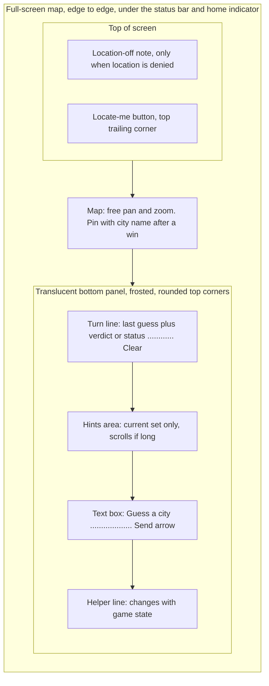

###### 3.1 Panel regions, top to bottom

| Region | Content | Notes |
|---|---|---|
| Turn line | Left side: the user's last guess plus the model's verdict, or a status indicator while busy. Right side: the Clear button. | Up to 3 lines of text. Placing Clear far from Send reduces mis-taps without hiding accidental ones you may want to observe. |
| Hints area | The current hints, one per line, in the regular body text style. | Shows about 5 lines at most before scrolling. Old hints dim to about 40% while a new reply is pending. |
| Text box + Send | A single-line text box with the placeholder "Guess a city". The Send button sits inside its trailing end, Messages-style. | The keyboard's return key also sends. |
| Helper line | Small secondary text whose wording depends on game state (see the copy table in section 9). | It's the main way people discover "give up" and "yes". |

**Panel height.** When the keyboard is hidden, the panel takes no more than about 40% of the screen height and grows only as tall as its content needs. When the keyboard is up, the panel rides directly above it.

**Clear button.** A small text button labeled "Clear" in the accent color. A trash icon was avoided because it suggests deleting something permanent rather than starting over.

**Send button.** A round up-arrow icon. Its touch target is at least 44 by 44 points.

###### 3.2 Send and Clear visual states

| State | Send | Clear |
|---|---|---|
| Text box empty or only spaces | Dimmed, not tappable | Enabled |
| Text box has text, app idle | Filled accent color, tappable | Enabled |
| Send in progress (thinking, streaming, sign-in, Face ID, map move) | A small spinner replaces the arrow, not tappable | Dimmed, not tappable |
| Clear in progress (starting a new game) | Dimmed, not tappable, even if the text box has text | A small spinner replaces the label |

The text box stays editable at all times, so users can type their next guess while waiting.

##### 4. Map behavior

| Situation | Behavior |
|---|---|
| Launch, location allowed | Centered on the user's location at neighborhood zoom, with the standard blue location dot. |
| Launch, location denied | A whole-world view. A small capsule note at the top reads "Location is off". Tapping it opens the app's page in the Settings app. It stays until location is allowed. |
| Locate-me button | A standard Maps-style button, top trailing. Tapping it flies back to the user's location. When location is denied, it shows a crossed-out location icon, and tapping it opens Settings. |
| During play | Free pan and zoom. The game never moves the map on its own except on a win. |
| Win, map move approved | An animated fly-to (about 1.5 seconds) at city-level zoom. A standard red pin labeled with the city name. A light success haptic tap when the pin lands. |
| Win, map move refused or failed | The map does not move. |
| New game starts (after "yes" or Clear) | The map stays put. The old pin is removed when the new game's first hints arrive (after "yes") or immediately (on Clear). |
| Reduce Motion is on | The fly-to becomes a quick cross-fade to the city. |

##### 5. Overall states

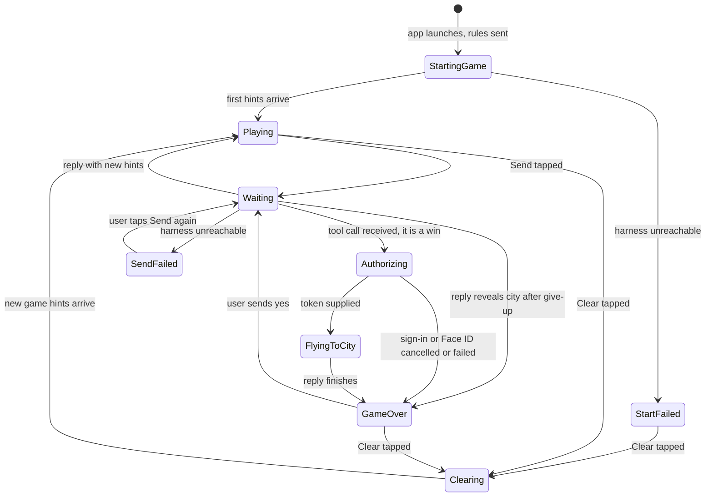

**When Clear's process ends.** "Clear in progress" lasts from the tap until the new game's first hints have finished arriving. Only then does Send become available again.

##### 6. Flows

###### 6.1 Launch and first game

1. The map appears immediately. If iOS has not asked yet, its location permission prompt appears over the screen.
2. The app sends the rules in the background. The turn line shows a small spinner with "Starting a game…". Send and Clear are both disabled.
3. As the reply streams in, hint lines fill the hints area, and any other text goes to the turn line.
4. Once the reply finishes, the helper line reads "Type a guess, or 'I give up' to reveal the city." Send becomes enabled as soon as there is text in the box.

###### 6.2 Wrong guess

1. The user types "Lisbon" and taps Send.
2. The text box empties. The turn line shows "Lisbon" followed by a spinner and "Thinking…". The old hints dim. Clear is disabled.
3. When text starts to arrive, the spinner disappears and the verdict streams into the turn line, for example "Lisbon · Not it — think further east."
4. When the first new hint line arrives, the dimmed old hints are replaced all at once with a gentle cross-fade, and the new hints fill in as they stream.
5. When the reply finishes, Send and Clear return to normal.

If a reply contains no recognizable hints, the old hints stay (no longer dimmed), and all the text goes to the turn line.

###### 6.3 Give up

1. The user types "I give up" and taps Send. It looks like a wrong guess at first.
2. The model's reveal ("It was Kyoto…") streams into the turn line. The hints stay visible, undimmed, so the user can connect them to the answer.
3. The map does not move, and no sign-in happens.
4. The helper line changes to "Type 'yes' to play again." This depends on the end-of-game marker discussed in challenge 1. Without it, the helper line keeps a combined fallback (see section 9).

###### 6.4 Win, including sign-in and Face ID

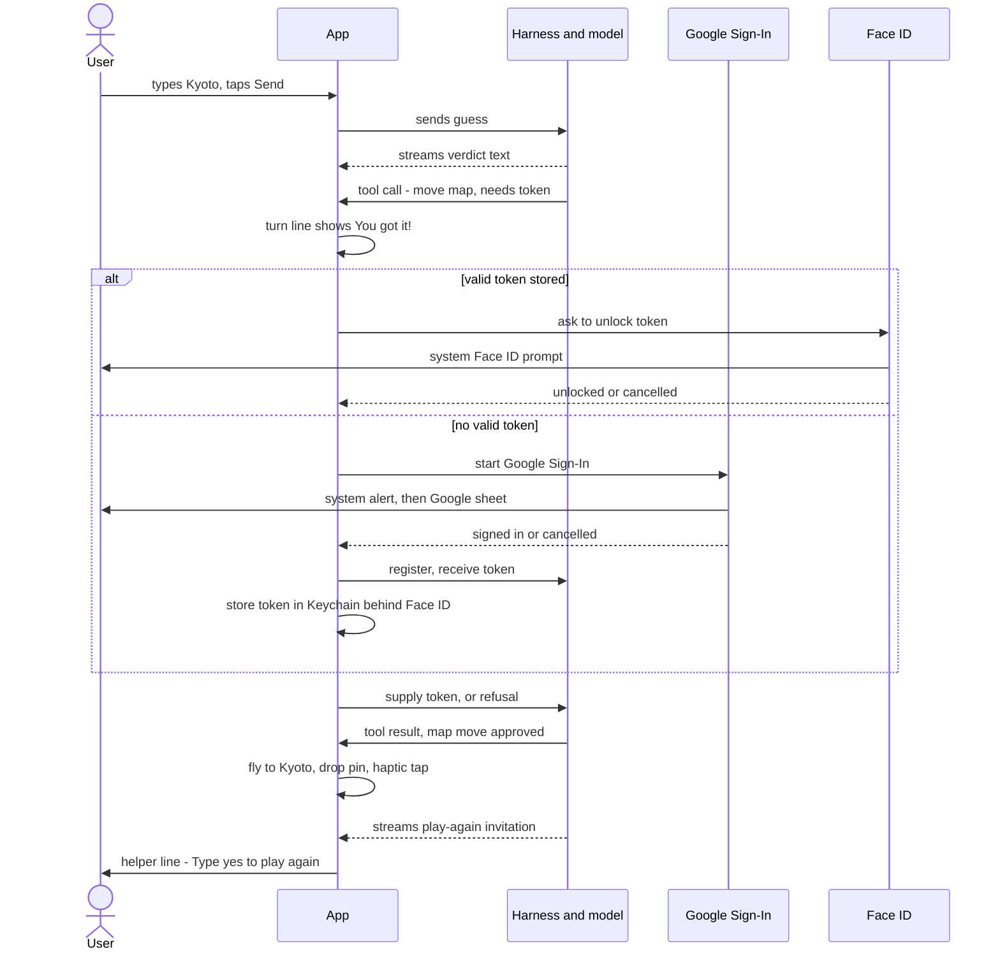

These are the turn line's status messages during a win, in the order they can appear:

| Moment | Turn line |
|---|---|
| Tool call arrives | "You got it!" plus a spinner and "Signing in to show it on the map…" (no token stored) or "Confirm with Face ID to show it on the map…" (token stored) |
| Token supplied | A spinner and "Moving the map…" |
| Map arrives | Model text streams in, for example "Correct — Kyoto! Play again?" |
| Sign-in or Face ID cancelled or failed | The model's text still shows the win and the city name. Beneath it, in small secondary text: "The map couldn't move because sign-in didn't finish." There is no retry. |

The Face ID system prompt shows a reason line. Plain-English wording: "Confirm it's you to show the mystery city on the map."

On the first win, there is no Face ID, because the fresh token is used directly. On the second win, iOS first asks once whether to allow Face ID, then scans.

Your game rules should ask the model to always name the city in its text, even if the map move fails. Requirement 3d depends on this.

###### 6.5 Play again

1. After a game ends, the user types "yes" and taps Send. This is the usual Waiting state.
2. When the new game's first hints arrive, the old pin is removed, the turn line shows the model's opening text, and the helper line goes back to the give-up wording.
3. The map stays where it is. The user can tap the locate-me button to return home.

###### 6.6 Clear

1. The user taps Clear, either mid-game or after a game. There is no confirmation.
2. Immediately, the pin (if any) is removed, the hints and turn line empty, the turn line shows a spinner with "Starting a new game…", Clear shows its spinner, and Send is disabled. Any text in the text box stays.
3. The conversation is wiped, and the rules are sent again.
4. When the first hints have finished arriving, both buttons return to normal.

The stored token is untouched. The map does not move.

###### 6.7 Errors (minimal)

| Situation | What the user sees |
|---|---|
| Harness unreachable when Send is tapped | Turn line: "Couldn't reach the game. Tap Send to try again." The guess is put back in the text box, and the dimmed hints return to normal. |
| Reply cuts off partway | The partial text stays. Below it: "The reply was cut off. Tap Send to try again." |
| Harness unreachable at launch or after Clear | Turn line: "Couldn't start a game. Tap Clear to try again." Clear stays enabled and acts as retry, and Send stays disabled. |

##### 7. Keyboard behavior

- Tapping the text box raises the keyboard, and the panel rides above it. Hints and the turn line stay visible.
- The keyboard stays up after sending, so rapid guessing doesn't require reopening it.
- Swiping down on the panel or tapping the map dismisses the keyboard, and the map becomes the hero again.
- The return key is labeled "Send" and behaves exactly like the Send button, including its disabled states.

##### 8. Light and dark mode, and accessibility

- The panel uses the standard system frosted background, which adapts to light and dark mode automatically. Text and icons use system label colors, and the map follows the system appearance.
- All text uses Dynamic Type. At very large sizes, the hints area scrolls instead of growing the panel past its cap.
- VoiceOver announces new hints once, when a reply finishes, rather than reading each streamed word. Status changes ("Signing in…", "Moving the map…") are announced too.
- Buttons have spoken labels: "Send guess", "Clear and start a new game", "Show my location".
- Color is never the only signal. The dimmed hints also change their spoken description to "previous hints".

##### 9. Text the app writes

| Where | Text |
|---|---|
| Text box placeholder | Guess a city |
| Helper line, during play | Type a guess, or "I give up" to reveal the city. |
| Helper line, after a game ends | Type "yes" to play again. |
| Helper line, fallback if the game's end can't be detected | Type a guess. Say "I give up" to reveal the city, or "yes" to play again. |
| Turn line statuses | Starting a game… / Thinking… / You got it! / Signing in to show it on the map… / Confirm with Face ID to show it on the map… / Moving the map… / Starting a new game… |
| Map-move failure | The map couldn't move because sign-in didn't finish. |
| Location note | Location is off |
| Face ID reason | Confirm it's you to show the mystery city on the map. |
| Errors | See section 6.7 |

##### 10. Moderator setup notes

- **Simulator Face ID.** Enroll Face ID from the Simulator's Features menu, then trigger a "matching face" or "non-matching face" when the prompt appears.
- **Resetting between participants.** Use the "Reset sign-in" switch on the app's page in the iOS Settings app. It deletes the stored token so the next participant gets the full first-win experience. Also sign the test Google account out between sessions.
- **Harness wait limit.** Before testing, confirm the harness waits at least 2 minutes for a tool result, so a slow sign-in doesn't break the win.

##### 11. Assumptions to confirm

- Your game rules can mark the end of a game, after a win or a give-up, in a recognizable way, the same way they mark hints.
- The re-center tool call includes the city name as well as latitude and longitude. If it doesn't, the pin label will come from Apple's map lookup and may read as a district or region.
- The model writes its verdict naming the city even when the map move is refused.
- When a sign-in or Face ID is cancelled, the harness passes a refusal back to the model, and the reply continues rather than stalling.


### E-A v2 (Elephant, after Goldfish 1 Round 1)
> New Elephant session given: requirements, look-and-feel, E-A v1, and the Goldfish 1 Round 1 audit (no chat history).

Below is the audit decision table, followed by Exhibit E-A v2. A few challenges and questions for you follow the spec.

##### Audit decisions

| # | Audit point | Decision | Why |
|---|---|---|---|
| 1 | The document isn't labeled "Exhibit E-A." | Accept | v2 is titled and versioned. |
| 2 | The full-screen map competes with the game and should stay in the background until a win. | Reject | The look-and-feel preference makes the map the full-screen, edge-to-edge hero. Mitigation: the helper line now says plainly that you play by typing. |
| 3 | Opening on the user's neighborhood misleads people, and the location prompt asks for something the game doesn't use. | Reject | UI requirement 1 says the map must launch centered on the user's location. Mitigation: the helper line says "The city could be anywhere in the world," and the location prompt now has written wording. |
| 4 | "Clear" is ambiguous. Rename it "New game." | Reject the rename, accept the fixes | UI requirement 4 specifies a button called "Clear." It has moved away from the last guess and has a fuller spoken label. |
| 5 | Clear has no confirmation, so games get lost by accident. | Accept | A confirmation appears when guesses have been made. |
| 6 | Clear leaves the typed text in the box. | Accept | Clear now empties the text box too. |
| 7 | The turn line is overloaded and has no rule for overflow. | Accept | It is split into a status row (app text) and a message area (model text), with a defined scrolling rule. |
| 8 | Nothing records past guesses, so people will repeat them. | Accept | A "Tried" row lists this game's guesses. |
| 9 | Earlier hints are lost and can't be compared with new ones. | Reject | UI requirement 2 says new hints overwrite old ones and only the current set is shown. |
| 10 | The "give up" research question tests whether people read small text, not whether they discover the feature. | Accept | The research question is reworded to measure understanding and willingness to give up. |
| 11 | The sign-in alert appears unexplained and uninvited. | Accept | An in-panel card explains the step, and the user taps "Show on Map" to start it. |
| 12 | Cancelling is final, there is no retry, and the message sounds like blame. | Accept | Cancelling returns to the card, which offers "Try Again" or "Not Now." The wording is neutral. |
| 13 | The reward should come first, and the gate later or not at all. | Partly accept | The celebration (haptic tap, "You got it!", city name) now comes first. The map move stays gated because game mechanic 3 requires an authorization token for the re-center. |
| 14 | Returning winners get a surprise second prompt (the one-time "Allow Face ID?" request). | Accept, done differently | All prompts now happen during the first win. This also fixes a v1 error: the first win skipped Face ID, which broke the requirement that every access to the token goes through Face ID. |
| 15 | Giving up should also move the map. | Reject | Game mechanic 2 makes the re-center tool call the reward for a correct guess. |
| 16 | The map stays on the old city into the next game. | Accept | The map flies back to the user's location when a new game starts. |
| 17 | "Challenge 1" and "Requirement 3d" are referenced but not explained. | Accept | The spec is now self-contained. |
| 18 | Harness connection type, endpoints, request and response shapes, and authentication. | Deferred to technical design | These are back-end data format questions. |
| 19 | Who owns the game rules text, and what does it say? | Partly accept | The spec lists what the rules must ask of the model. Exact wording and encoding are deferred to technical design. |
| 20 | How hints, verdicts, and reveals are told apart in the incoming data. | Deferred to technical design | The visual handling of each is defined here. |
| 21 | Does the end-of-game marker exist? | Deferred to technical design | The marker's format is deferred. The spec defines the helper line's behavior with and without it. |
| 22 | Tool-call format, whether it includes the city name, and how a result or refusal is returned. | Deferred to technical design | This is a tool-call format question. |
| 23 | Is a win detected only by the tool call? What if the model says "Correct!" without one? | Accept | Defined in flow 6.5. |
| 24 | Google Sign-In SDK, client ID, and the endpoint that issues the token. | Deferred to technical design | This is sign-in plumbing. |
| 25 | Token validity and expiry, and what happens if the harness rejects a token after Face ID unlocks it. | Partly accept | What the user sees is defined. The expiry mechanics are deferred to technical design. |
| 26 | Face ID unavailable, not enrolled, or locked out. Should there be a passcode fallback? | Accept the states, reject the fallback | The states are defined. Game mechanic 3 requires a biometric (Face ID) check, so there is no passcode fallback. |
| 27 | The one-time Face ID permission alert needs its own wording. | Accept | The wording is in the copy table. |
| 28 | The app is backgrounded mid-sign-in, or the harness wait expires. | Accept, with one part deferred | What the user sees is defined. The wait length is deferred to technical design. |
| 29 | "Tap Send to try again" doesn't work after a cut-off reply, because the text box is empty. | Accept | The guess is put back in the text box. |
| 30 | Clear can't be used from the failed-send or waiting states. | Accept for failed-send, reject for waiting | After a failed send, nothing is in progress, so Clear works. During waiting, UI requirement 4 says Send disables Clear until Send's process is complete. |
| 31 | No message if the approved map move itself fails. | Accept | Defined. |
| 32 | No rule for typing something other than "yes" after a game ends. | Accept | Whatever the user types is sent as-is, and the model decides what happens. |
| 33 | Does "You got it!" get replaced or appended when the model's text arrives? | Accept | App text and model text now live in separate areas. |
| 34 | No panel height cap when the keyboard is up, which is a problem on small iPhones. | Accept | A cap is defined. |
| 35 | Is iPad or landscape supported? | Accept | iPhone only, portrait only. |
| 36 | Minimum iOS version. | Deferred to technical design | It decides which APIs are available, not any interaction. |
| 37 | No wording for the location prompt. Why not ask when locate-me is tapped instead? | Accept the wording, reject asking later | UI requirement 1 needs the user's location at launch. |
| 38 | The "Reset sign-in" switch needs a Settings bundle. | Accept, with the build deferred | It ships in all builds, because every build is a prototype. How it is built is deferred to technical design. |
| 39 | Why does the map move need sign-in at all? | Reject | Game mechanic 3 requires a Google-backed, Face ID-guarded token. |

#### Exhibit E-A v2 — Mystery City: UX Interaction Specification (Usability Prototype)

Supersedes E-A v1. iPhone only, portrait only.

##### 0. Plain-English glossary

- **Model**: the AI that runs the game. It picks the city, writes hints, and judges guesses.
- **Harness**: the existing back-end program that passes messages between the app and the model. It cannot be changed, except for one added command that erases the conversation (used by Clear).
- **Hints**: short clues about the mystery city. Only the latest set is ever shown.
- **Move-map request**: when the user guesses correctly, the model asks the app to move the map to the city. This is the "tool call."
- **Token**: a time-limited pass the app gives the model so the move-map request is allowed. Getting one requires Google Sign-In. It is stored encrypted on the iPhone and can only be read after a Face ID check. While it is still valid, it can be reused without signing in again.
- **Game rules**: the instructions the app sends the model at the start of every game.

##### 1. Purpose, scope, and research questions

A single-screen guessing game. The model secretly picks a world city and gives hints. The user types guesses. A correct guess sends the map flying to the city, after a sign-in and Face ID step.

Research questions:
1. Are the hints clear enough for people to reach the answer?
2. Do people understand that they can give up, and do they choose to? The helper line tells them how, so this measures understanding and willingness, not discovery.
3. How do people react when a sign-in is needed to see their reward, and do they complete it?
4. Do people understand what Clear does before and after they tap it?

Each session covers starting a game, wrong guesses, one give-up, one win (including sign-in and Face ID), a second win (Face ID only), and using Clear.

Out of scope: iPad, landscape, account setup, saved games, Touch ID, passcode fallback, feedback or reporting, payments, and subscriptions.

##### 2. Requirements this spec must satisfy (restated)

- **R-Map**: On launch, the map is centered on the user's current location.
- **R-Hints**: Hints appear above the text box. New hints replace old ones, and only the current set is shown.
- **R-Send**: The Send button shows whether there is anything to send. When tapped, it sends the text to the harness and shows that a reply is in progress.
- **R-Clear**: The Clear button erases all conversation history, including the game rules and the user's messages. While Clear's process runs, Send is disabled. While Send's process runs, Clear is disabled.
- **R-City**: The model, not the app, picks the city. The city stays the same for the whole game and is revealed only when the game ends, by a correct guess or by giving up.
- **R-Win**: On a correct guess, the model sends a move-map request that re-centers the map on the city, then invites the user to play again.
- **R-Token**: The move-map request needs a token from the app. Getting a token requires Google Sign-In. The token has a limited lifetime and can be reused while valid. It is stored encrypted in the iPhone's Keychain, and every read goes through the Secure Enclave behind a Face ID check.
- **Look and feel**: a full-screen, edge-to-edge map; a translucent bottom panel holding the hints, text box, Send, and Clear; system font and SF Symbols; light and dark mode; status shown in place, never as full-screen interruptions; Apple Human Interface Guidelines throughout.

##### 3. Design principles

- **The map is the hero.** It fills the screen. Only the keyboard and system sheets (sign-in, Face ID, confirmations) cover it.
- **There is one screen.** There is no navigation. The app draws no sheets, only a standard system confirmation for Clear.
- **App text and model text never share a space.** The status row holds the app's own words. The message area holds the model's words.
- **The user starts any interruption.** No system sign-in or Face ID prompt appears unless the user just tapped "Show on Map."
- **The app says only what it knows.** Statuses come from events the app can be sure of: Send tapped, text arriving, move-map request received, sign-in result, map arrived.

##### 4. Screen anatomy

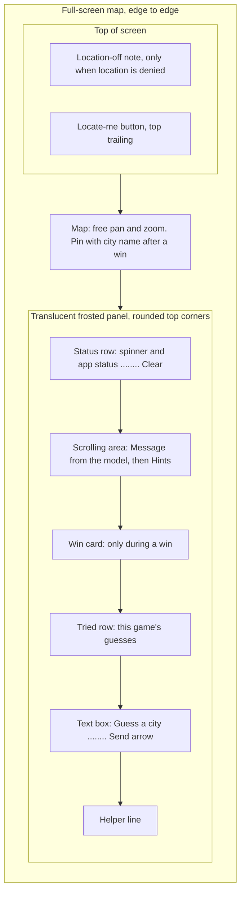

###### 4.1 Panel regions, top to bottom

| Region | Content | Rules |
|---|---|---|
| Status row | Left: a small spinner and a short app status, or a warning icon and an error. Right: the Clear button. | Contains app-written text only. One line, or two lines for errors. Its height stays fixed so the panel doesn't jump. It is blank when idle. |
| Message area | The model's latest non-hint text: the verdict, the reveal, the opening line, the play-again invitation. | Model text only. Each new reply replaces the previous message. It wraps in full and is never truncated. |
| Hints | A small "Hints" caption, then the current hints, one per line. | Only the current set (R-Hints). While a reply is pending, the old hints dim to about 40%. When the first new hint arrives, they are replaced in a single cross-fade. |
| Win card | Explains the sign-in or Face ID step and offers buttons. | Appears only during a win (see 6.4). |
| Tried row | "Tried:" followed by this game's guesses as small capsules, newest last. | Scrolls sideways if long. Hidden before the first guess. Emptied when a new game starts. Recorded by the app, not the model. |
| Text box and Send | Single-line text box with the placeholder "Guess a city", and a round up-arrow Send button inside its trailing end. | The return key also sends. Send's touch target is at least 44 by 44 points. |
| Helper line | Small secondary text that changes with the game state. | See the copy table in section 10. |

**Scrolling.** The message area and hints share one scrolling region. Everything else stays fixed. When new text arrives, the region scrolls to show the message first.

**Height caps.** With the keyboard hidden, the panel grows only as tall as its content needs, up to about 45% of the screen. With the keyboard up, the panel sits directly above it, and the scrolling region shrinks to a minimum of 3 lines. On small iPhones, very little map shows while typing. Dismissing the keyboard restores it.

**Clear button.** A small text button reading "Clear" in the accent color, at the trailing end of the status row, away from the guess and the text box. Spoken label: "Clear game and start over."

###### 4.2 Send and Clear states

| Situation | Send | Clear |
|---|---|---|
| Text box empty or only spaces | Dimmed, not tappable | Enabled |
| Text box has text, nothing in progress | Filled accent color, tappable | Enabled |
| Send in progress: thinking, replying, win card, sign-in, Face ID, map moving | A spinner replaces the arrow, not tappable | Dimmed, not tappable |
| Clear in progress, or a game is starting at launch | Dimmed, not tappable | A spinner replaces the label |
| After an error | Enabled if there is text | Enabled |

The text box stays editable at all times, so people can type their next guess while waiting.

##### 5. Map behavior

| Situation | Behavior |
|---|---|
| Launch, location allowed | Centered on the user at neighborhood zoom, with the standard blue location dot. |
| Launch, location denied | A whole-world view. A small capsule note at the top reads "Location is off." Tapping it opens the app's page in Settings. |
| Locate-me button | Standard Maps-style button, top trailing. Flies back to the user's location. When location is denied, it shows a crossed-out icon and opens Settings. |
| During play | Free pan and zoom. Tapping the map dismisses the keyboard and does nothing else. |
| Win, map move approved | The keyboard is dismissed, then an animated fly-to (about 1.5 seconds) at city zoom, with a red pin labeled with the city name. |
| Win, map move refused | The map stays put. |
| Win, map move approved but the map can't show it | The map stays put. Status row: "Couldn't show [city] on the map." |
| New game starts, after "yes" or Clear | The pin is removed and the map flies back to the user's location, or to the whole-world view if location is denied. |
| Reduce Motion is on | Every fly-to becomes a quick cross-fade. |

##### 6. Flows

###### 6.1 Overall states

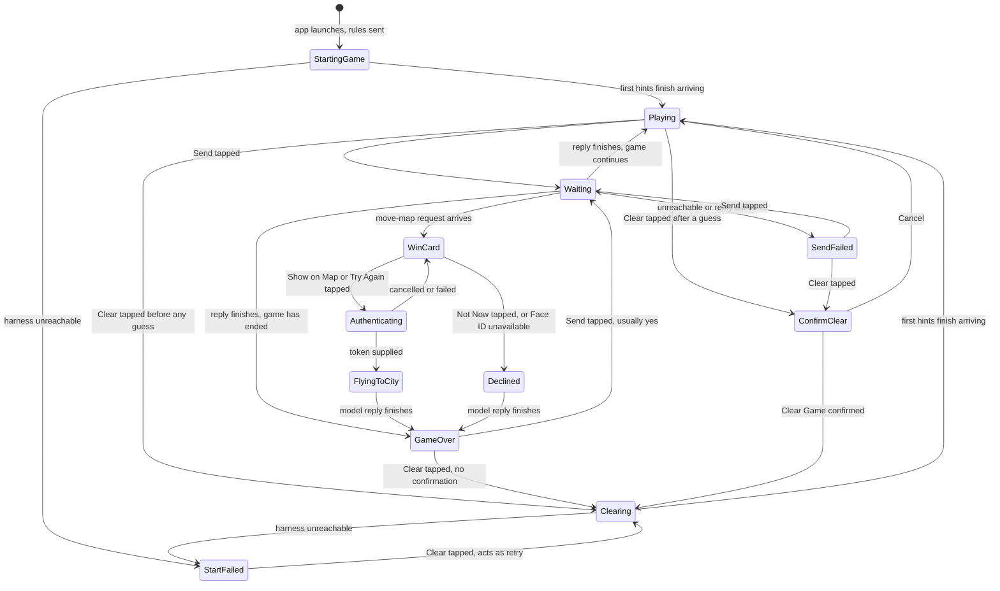

Send's process covers Waiting, WinCard, Authenticating, Declined, and FlyingToCity. Clear is disabled throughout (R-Clear). Clear's process covers Clearing and StartingGame. Send is disabled throughout.

###### 6.2 Launch and first game

1. The map appears immediately. If iOS hasn't asked before, the location prompt appears (wording in section 10).
2. The app sends the game rules in the background. The status row shows a spinner and "Starting a game…". Send and Clear are disabled.
3. The model's opening text streams into the message area, and hint lines fill the hints area.
4. When the reply finishes, the status row clears and the helper line reads "The city could be anywhere in the world. Type a guess, or "I give up" to reveal it."

###### 6.3 Wrong guess

1. The user types "Lisbon" and taps Send.
2. The text box empties, "Lisbon" is added to the Tried row, the status row shows a spinner and "Thinking…", the old hints dim, and Clear is disabled.
3. When text starts arriving, the status row clears and the verdict streams into the message area, for example "Not it. Think further east."
4. When the first new hint arrives, the old hints are swapped out in a single cross-fade.
5. When the reply finishes, Send and Clear return to normal.

If a reply contains no recognizable hints, the old hints stay and lose their dimming.

###### 6.4 Win, including sign-in and Face ID

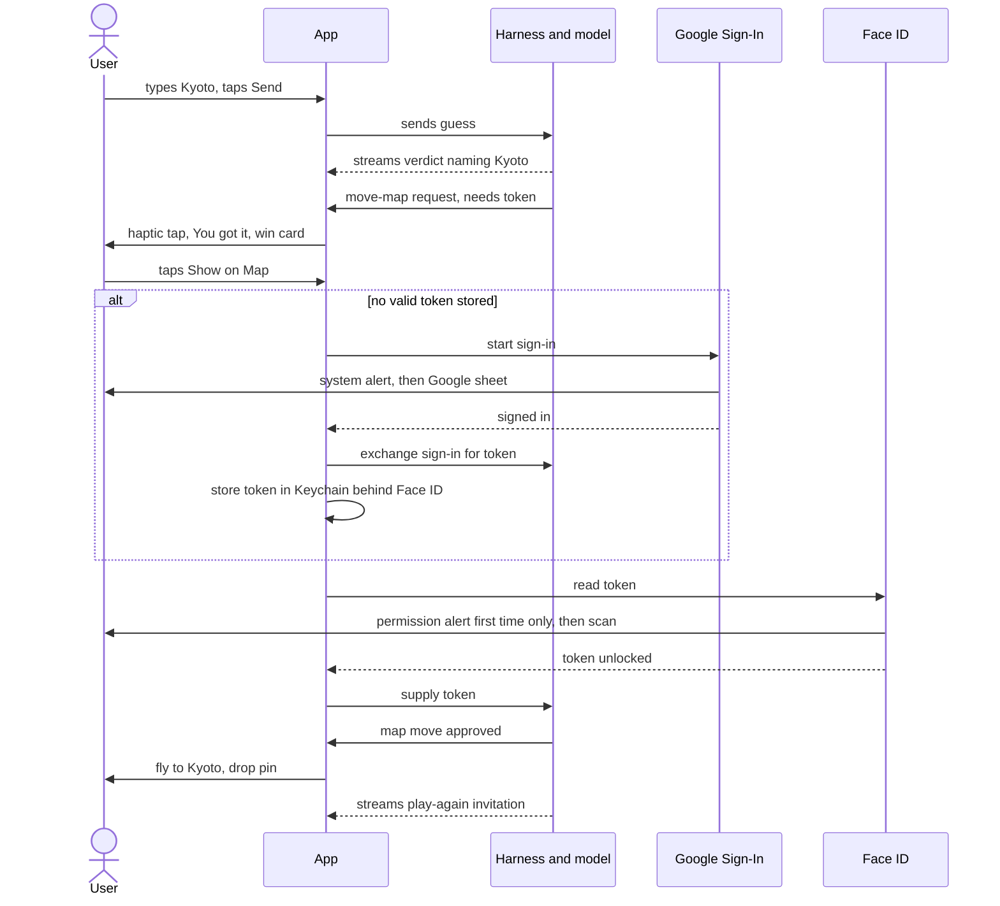

Every read of the token goes through Face ID, including the first win (R-Token). So all first-time prompts happen together during the first win, and later wins show only a Face ID scan.

**Step by step:**
1. When the move-map request arrives, the app plays a success haptic tap, dismisses the keyboard, and shows "You got it!" with a checkmark in the status row. The model's verdict, which names the city, stays in the message area.
2. The win card appears:
   - No valid token: "Sign in with Google to see the city on the map." Buttons: **Show on Map** (prominent) and **Not Now**.
   - Valid token stored: "Confirm with Face ID to see the city on the map." Same buttons.
3. Tapping Show on Map starts the system steps. The status row shows "Signing in…" or "Checking Face ID…".
4. Once the token is supplied, the card disappears, the status row shows "Moving the map…", the map flies to the city, and the pin drops.
5. The model's play-again invitation streams into the message area. The helper line changes to the play-again wording.

**Win card outcomes:**

| What happens | What the user sees |
|---|---|
| Sign-in or Face ID cancelled, or the scan fails | The card returns with "Sign-in didn't finish." and buttons **Try Again** and **Not Now**. |
| Not Now tapped | The card disappears. The model's text still names the city. Status row: "The map stayed put." The game ends normally. |
| Face ID not set up, unavailable, or locked out | The card reads "Face ID isn't available on this iPhone, so the map can't move." with an **OK** button. Tapping OK behaves like Not Now. |
| Stored token is rejected or has expired | The card reads "Your sign-in has expired. Sign in again to see the city." with **Sign In** and **Not Now**. The old token is deleted. |
| App goes to the background mid-sign-in | On return, if sign-in didn't finish, the card shows the Try Again version. |
| The harness stops waiting for an answer | The card disappears. Status row: "This win timed out before sign-in finished." The game ends normally. How long the harness waits is deferred. |

The Face ID scan screen shows a reason line, and the one-time permission alert has its own wording. Both are in section 10.

###### 6.5 Win detection without a move-map request

The app treats a guess as a win only when a move-map request arrives. If the model says "Correct!" without one, the app shows its text, with no celebration, card, or map move. If the end-of-game marker (section 8) arrives, the helper switches to the play-again wording. Moderators should note when this happens, because it means the game rules need fixing.

###### 6.6 Give up

1. The user types "I give up" and sends. It starts out like a wrong guess.
2. The model's reveal ("It was Kyoto…") streams into the message area. The hints lose their dimming and stay visible, so people can match them to the answer.
3. The map doesn't move and no sign-in happens. A give-up is not a win (R-Win).
4. The helper line changes to "Type "yes" to play again." This needs the end-of-game marker. Without it, the helper uses the combined fallback wording.

###### 6.7 Play again

1. After a game ends, the user types "yes" and sends. It behaves like a normal guess. Anything else typed is sent as-is, and the model decides how to respond. "yes" is not added to the Tried row once a game has ended.
2. When the new game's first hints arrive, the pin is removed, the map flies back to the user's location, the Tried row empties, and the helper returns to the in-play wording.

###### 6.8 Clear

1. The user taps Clear.
   - If at least one guess has been made and the game hasn't ended, a standard system confirmation appears: "Clear this game?" / "Your hints and guesses will be erased, and a new mystery city will be chosen." Buttons: **Clear Game** (red) and **Cancel**.
   - Otherwise, Clear proceeds without confirmation.
2. Immediately, the text box, message area, hints, and Tried row empty, the pin is removed, and the map flies back to the user's location. The status row shows "Starting a new game…", Clear shows a spinner, and Send is disabled.
3. The app tells the harness to erase the whole conversation (rules and messages), then sends the game rules again.
4. When the first hints finish arriving, both buttons return to normal.

The stored token is kept.

###### 6.9 Errors

| Situation | What the user sees |
|---|---|
| Harness unreachable when Send is tapped | Status row, with a warning icon: "Couldn't reach the game. Tap Send to try again." The guess goes back into the text box, its Tried capsule is removed, and the hints return to normal. |
| Reply cuts off partway, or stalls with no text for too long | The partial text stays in the message area. Status row: "The reply was cut off. Tap Send to try again." The guess goes back into the text box. How long counts as too long is deferred. |
| Harness unreachable at launch or after Clear | Status row: "Couldn't start a game. Tap Clear to try again." Clear acts as retry, and Send stays disabled. |

##### 7. Keyboard

- Tapping the text box raises the keyboard. The panel sits above it, and the status row and messages stay visible.
- The keyboard stays up after sending, so rapid guessing is easy.
- Swiping down on the panel or tapping the map dismisses the keyboard.
- The return key is labeled "Send" and follows Send's states exactly.
- The keyboard closes on its own when a win starts, so the fly-to can be seen.

##### 8. What the game rules must ask of the model

The exact wording and the data markers are deferred to technical design. The rules must:

1. Pick one real world city, keep it for the whole game, and never name it before the game ends (R-City).
2. Mark hints so the app can tell them apart from other text.
3. On a correct guess, send the move-map request with the city's position, and ideally its name as well.
4. When a game ends, by a win or a give-up, always name the city in its text, even if the map doesn't move.
5. Mark the end of a game so the app can switch the helper line.
6. Treat "yes" after a game as a request for a new game with a new city.
7. Recognize "I give up" and similar phrases as giving up.

##### 9. Light and dark mode, and accessibility

- The panel uses the standard system frosted background. Text uses system label colors, and the map follows the system appearance.
- All text supports Dynamic Type. At large sizes, the scrolling region scrolls instead of the panel growing past its cap.
- VoiceOver reads new messages and hints once each, when a reply finishes, not word by word. Status changes and win card changes are announced.
- Spoken labels: "Send guess", "Clear game and start over", "Show my location", "Show the city on the map", "Not now". Dimmed hints are announced as "previous hints".
- Color is never the only signal: errors also have an icon, and the win also has a checkmark.

##### 10. Text the app writes

| Where | Text |
|---|---|
| Placeholder | Guess a city |
| Helper, during play | The city could be anywhere in the world. Type a guess, or "I give up" to reveal it. |
| Helper, after a game | Type "yes" to play again. |
| Helper, fallback if the end of a game can't be detected | Type a guess. Say "I give up" to reveal the city, or "yes" to play again. |
| Statuses | Starting a game… / Thinking… / You got it! / Signing in… / Checking Face ID… / Moving the map… / Starting a new game… / The map stayed put. |
| Win card | Sign in with Google to see the city on the map. / Confirm with Face ID to see the city on the map. / Sign-in didn't finish. / Your sign-in has expired. Sign in again to see the city. / Face ID isn't available on this iPhone, so the map can't move. |
| Win card buttons | Show on Map / Try Again / Sign In / Not Now / OK |
| Clear confirmation | Clear this game? / Your hints and guesses will be erased, and a new mystery city will be chosen. / Clear Game / Cancel |
| Map failures | Couldn't show [city] on the map. / This win timed out before sign-in finished. |
| Location note | Location is off |
| Location prompt wording | Mystery City starts the map where you are. Your location isn't used in the game. |
| Face ID permission wording (one time) | Mystery City uses Face ID to protect your sign-in before showing a city on the map. |
| Face ID scan reason | Confirm it's you to show the mystery city on the map. |
| Errors | See 6.9 |

##### 11. Moderator setup notes

- **Face ID in the Simulator:** enroll Face ID from the Features menu, then choose a matching or non-matching face when the prompt appears. To test the "Face ID unavailable" path, leave it unenrolled.
- **Resetting between participants:** turn on "Reset sign-in" on the app's page in the Settings app. Deleting the app is not enough, because Keychain items survive deletion. Also sign the test Google account out in Safari, and reset location permission under Settings > General > Transfer or Reset.
- **Before testing:** confirm the harness waits long enough for a slow sign-in, and run one full win to check that the game rules produce hints, the end-of-game marker, and the move-map request.

##### 12. Deferred to technical design

- How the app connects to the harness (streaming method, endpoints, request and response shapes, any harness sign-in).
- How hints, the end-of-game marker, and other text are marked in the data.
- The exact move-map request format, whether it includes the city name, and how a token or refusal is sent back.
- The exact game rules text.
- Google Sign-In library and client setup, and how a sign-in is exchanged for a token.
- Token lifetime, how expiry is checked, and how a rejected token is detected.
- How long the harness waits for a token, and when a stalled reply counts as an error.
- Minimum iOS version and the matching frosted-panel and map features.
- How the "Reset sign-in" switch is built.
- Code structure and naming, which must follow the llmTools and llmHITL tutorials.

##### 13. Open product questions

1. Should the Clear confirmation stay? It prevents accidental clears, but then the test can't observe whether people clear by accident.
2. Is the sign-in-at-the-win moment something you're testing (research question 3), or just plumbing to satisfy the token requirement? If it's plumbing, the friction is a cost with no research benefit.

##### Challenges for you

**Face ID on the first win.** v1 used the fresh token on the first win without a Face ID check. I read the requirement that all token access goes through Face ID as forbidding that, so v2 makes the first win the heaviest moment: system alert, Google sheet, the one-time Face ID permission alert, then the scan. That's four system screens in a row at the emotional peak. I think that's correct under your requirements, but please confirm it's what you intend.

**Clear confirmation versus observing mistakes.** I added a confirmation to protect players, but it removes your chance to see whether people clear games by accident. If observing mistakes matters more, drop the confirmation and keep the relocation.

**Is sign-in at the win the thing you're testing?** If it isn't a research question, the friction is a cost with no benefit to you, and an earlier sign-in would serve your test better. A pre-game sign-in is close to the "account setup" you excluded, though, so I didn't design it. Which matters more to you: testing reactions to the gate at the win, or keeping the win moment clean?

### E-A v3 — FINAL (Elephant, after Goldfish 2 Round 1)
> New Elephant session given: requirements, look-and-feel, E-A v2, the Goldfish 2 audit, and my decisions (Face ID on every read; keep Clear confirmation; gate stays at win; keep helper line + locate-me, drop Tried row + Reset switch; Clear keeps half-typed guess).

##### Decision table

| Audit point | Decision | Why |
|---|---|---|
| Token exchange may need a harness change | Accept | v3 states that the exchange uses the existing llmHITL `/addagent` endpoint, with no harness API changes and no new harness login. |
| Win card can't know if the token is valid without reading it | Accept | The app keeps a non-secret note of when the token expires. The card picks its wording from that note, and the token itself stays behind Face ID. |
| Send's spinner runs while waiting on the user | Accept in part | The spinner now shows only during real work. Clear stays disabled while the card waits, because the model's turn (Send's process) is still open (R-Clear). |
| Architecture baseline can't be checked | Accept in part | v3 names SwiftUI and MapKit and maps the flows onto the llmTools and llmHITL steps. Code structure stays deferred. |
| "Not Now" skips the required tool call | Accept (clarify) | The model still makes the tool call. Not Now is the human declining it, which is the llmHITL approval path, and research question 3 needs a way to decline. |
| State diagram missing paths | Accept in part | Expired token and the Face ID "OK" step are added. Map failure, harness timeout, and backgrounding are trimmed as hardening. |
| Status row can't be fixed height and two lines | Accept | One line, with error text written to fit it. |
| Return key can't follow Send's states | Accept | Return is disabled when the box is empty and does nothing while Send is disabled. |
| Clear wipes the half-typed guess | Accept | Your decision 5. |
| Map barely visible | Accept in part | The panel cap drops to about one third of the screen, and the scroll area to 2 lines with the keyboard up. The keyboard covering the map is unavoidable. |
| Status row, message area, and win card crowd the panel | Reject | Each one serves a requirement: in-progress status (R-Send), the reveal and play-again invite (R-City, R-Win), and the gate at the win (decision 3). |
| Clear and location touch targets | Accept | 44 by 44 points minimum. The location note is removed anyway. |
| Send and Clear don't match | Reject | Clear keeps a text label on purpose, because research question 4 depends on people reading the word. |
| 40% dimmed hints fail contrast | Accept | Old hints use the system secondary text color and a "Previous hints" caption instead of fading. |
| Google prompts break "no full-screen interruptions" | Accept | Stated as the one intended exception. |
| "Show on Map" lacks Google branding | Accept | When sign-in is needed, the button is Google's standard "Sign in with Google" button. |
| Tried row | Accept | Dropped (decision 4). |
| Helper line | Reject | Kept (decision 4). |
| Clear confirmation | Reject | Kept (decision 2). |
| Locate-me button and location note | Accept in part | The button stays (decision 4). The separate note is dropped, because the crossed-out button already opens Settings. |
| Pin and haptic | Accept in part | The pin with the city name stays, since it is the visible result of the tool call. The haptic is dropped. |
| "Reset sign-in" Settings switch | Accept | Dropped (decision 4). |
| Reliability hardening | Accept | Trimmed: stall timeouts, guess restore, background recovery, win timeout, and deleting rejected tokens. |
| "Any harness sign-in" | Accept | Ruled out explicitly. |

#### Exhibit E-A v3 (FINAL) — Mystery City: UX Interaction Specification (Usability Prototype)

Supersedes E-A v2. iPhone only, portrait only. Built in SwiftUI with Apple MapKit.

##### 0. Plain-English glossary

- **Model**: the AI that runs the game. It picks the city, writes hints, and judges guesses.
- **Harness**: the existing back-end program that passes messages between the app and the model. Its API, data format, and database cannot change. The only added command is the one that erases the conversation, used by Clear.
- **Hints**: short clues about the mystery city. Only the latest set is ever shown.
- **Move-map request**: when the user guesses correctly, the model asks the app to move the map to the city. This is the "tool call."
- **Approval step**: the moment the user decides whether to let the move-map request go ahead, by signing in and passing Face ID.
- **Token**: a time-limited pass the app gives the model so the move-map request is allowed. Getting one requires Google Sign-In. It is stored encrypted on the iPhone and can only be read after a Face ID check. While it is valid, it can be reused without signing in again.
- **Game rules**: the instructions the app sends the model at the start of every game.

##### 1. Purpose, scope, and research questions

This is a single-screen guessing game. The model secretly picks a world city and gives hints. The user types guesses. A correct guess sends the map flying to the city, after a sign-in and Face ID step.

Research questions:
1. Are the hints clear enough for people to reach the answer?
2. Do people understand that they can give up, and do they choose to? The helper line tells them how, so this measures understanding and willingness, not discovery.
3. How do people react when a sign-in is needed to see their reward, and do they complete it? The gate sits at the win on purpose.
4. Do people understand what Clear does before and after they tap it?

Each session covers starting a game, wrong guesses, one give-up, one win (including sign-in and Face ID), a second win (Face ID only), and using Clear.

**The one intended exception to "no full-screen interruptions":** the Google sign-in alert and sheet, and the system Face ID prompts. These are system screens that can't be avoided, and they are the subject of research question 3.

**Out of scope:**
- iPad and landscape.
- Account setup and saved games.
- Touch ID and passcode fallback.
- Feedback or reporting, payments, and subscriptions.
- Reliability hardening: timeouts, retries beyond "try again," and recovery after the app goes to the background.
- Any change to the harness API, and any harness login.

##### 2. Requirements this spec must satisfy (restated)

- **R-Map**: On launch, the map is centered on the user's current location.
- **R-Hints**: Hints appear above the text box. New hints replace old ones, and only the current set is shown.
- **R-Send**: The Send button shows whether there is anything to send. When tapped, it sends the text to the harness and shows that a reply is in progress.
- **R-Clear**: The Clear button erases all conversation history, including the game rules and the user's messages. While Clear's process runs, Send is disabled. While Send's process runs, Clear is disabled.
- **R-City**: The model, not the app, picks the city. The city stays the same for the whole game and is revealed only when the game ends, by a correct guess or by giving up.
- **R-Win**: On a correct guess, the model makes a move-map request to re-center the map on the city, then invites the user to play again.
- **R-Token**: The move-map request needs a token from the app. Getting a token requires Google Sign-In. The token has a limited lifetime and can be reused while valid. It is stored encrypted in the iPhone's Keychain, and every read, including the first one, goes through the Secure Enclave behind a Face ID check.
- **R-Arch**: The structure and naming follow the llmTools and llmHITL tutorials. The harness is unchanged apart from the erase command.
- **Look and feel**:
  - a full-screen, edge-to-edge map,
  - a translucent bottom panel holding the hints, text box, Send, and Clear,
  - system font and SF Symbols,
  - light and dark mode,
  - status shown in place,
  - Apple Human Interface Guidelines throughout.

###### 2.1 How the flows map onto the tutorials

- **llmTools:** the move-map request is a tool call that the app carries out on the device.
- **llmHITL:** the win card, sign-in, and Face ID together form the human approval step for that tool call. Approving supplies the token, and declining (Not Now) refuses the call. In both cases, the model then finishes its reply.
- **Token exchange:** after Google Sign-In, the app exchanges the sign-in for a token using the existing llmHITL `/addagent` endpoint. There are no harness API changes and no new harness login.
- **Clear:** uses the one added command, `/llmclear`, then sends the game rules again.

##### 3. Design principles

- **The map is the hero.** It fills the screen. Only the keyboard, the panel, and system prompts cover it.
- **There is one screen.** There is no navigation. The app draws no sheets of its own, only a standard system confirmation for Clear.
- **App text and model text never share a space.** The status row holds the app's own words. The message area holds the model's words.
- **The user starts any interruption.** No sign-in or Face ID prompt appears unless the user just tapped a button on the win card.
- **The app says only what it knows.** A spinner appears only while the app or harness is actually working, never while the app is waiting on the user.

##### 4. Screen anatomy

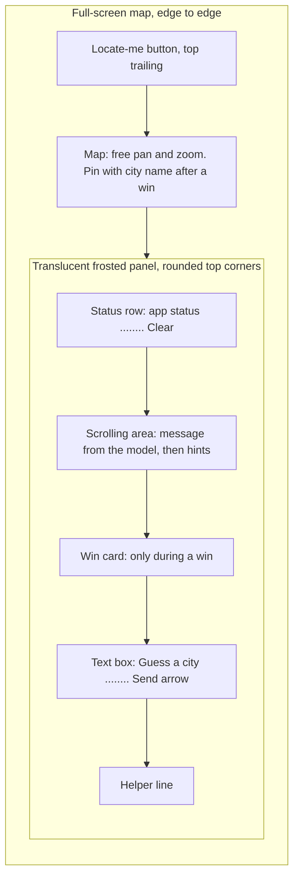

**Wireframes.** These are mermaid wireframes of the single game screen in its main states. They were added in the 10/29 resubmission in response to instructor feedback. They draw §4–§6 of this spec and change nothing in the design.

**Wireframe 1: Playing (launch and guessing)**

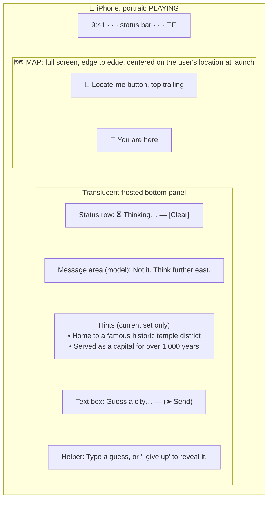

**Wireframe 2: Win (approval step for the re-center tool call)**

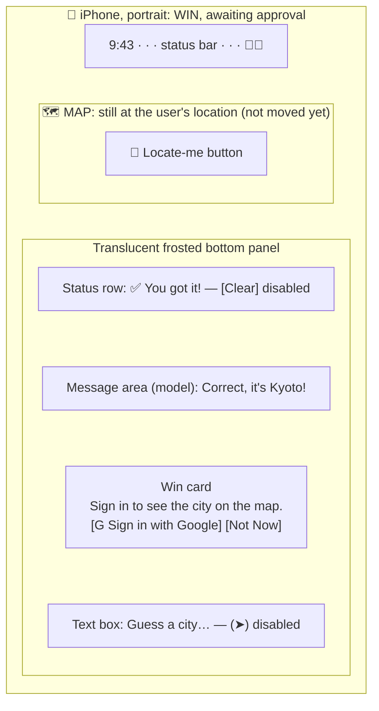

**Wireframe 3: Game over (after the map moves)**

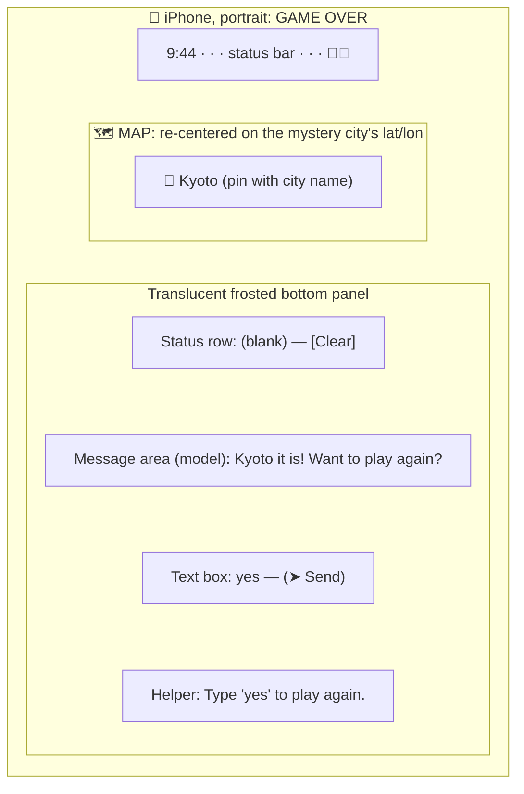

###### 4.1 Panel regions, top to bottom

| Region | Content | Rules |
|---|---|---|
| Status row | Left: a short app status, with a small spinner while work is happening, a checkmark on a win, or a warning icon on an error. Right: the Clear button. | App-written text only. Always exactly one line tall, and all status and error text is written to fit one line. It is blank when idle. At very large text sizes it may wrap, and that is acceptable. |
| Message area | The model's latest non-hint text: the opening line, the verdict, the reveal, and the play-again invitation. | Model text only. Each new reply replaces the previous message. It wraps in full and is never cut short. |
| Hints | A small "Hints" caption, then the current hints, one per line. | Only the current set is shown (R-Hints). While a reply is pending, the caption reads "Previous hints" and the hints switch to the system secondary text color. Opacity is not used, so the text stays readable. When the first new hint arrives, the old set is replaced in a single cross-fade. |
| Win card | Explains the approval step and offers buttons. | Appears only during a win (see 6.4). |
| Text box and Send | A single-line text box with the placeholder "Guess a city", and a round up-arrow Send button (SF Symbol) at its trailing end. | Send's touch target is at least 44 by 44 points. |
| Helper line | Small secondary text that changes with the game state. | See section 10. |

**Scrolling.** The message area and hints share one scrolling region, and everything else stays fixed. When new text arrives, the region scrolls to show the message first.

**Height caps.** With the keyboard hidden, the panel grows only as tall as its content needs, up to about one third of the screen. With the keyboard up, the panel sits directly above it, and the scrolling region shrinks to a minimum of 2 lines. The keyboard covering most of the map while typing is accepted. Dismissing the keyboard restores the map.

**Clear button.** A text button reading "Clear" in the accent color, at the trailing end of the status row, away from the text box. Its touch target is at least 44 by 44 points, and its spoken label is "Clear game and start over." It is a text label rather than a symbol on purpose, because research question 4 depends on people reading the word.

###### 4.2 Send and Clear states

| Situation | Send | Clear |
|---|---|---|
| Text box empty or only spaces | Dimmed, not tappable | Enabled |
| Text box has text, nothing in progress | Filled accent color, tappable | Enabled |
| Waiting on the model: thinking or replying | A spinner replaces the arrow, not tappable | Dimmed, not tappable |
| Win card waiting for the user | Dimmed arrow (no spinner), not tappable | Dimmed, not tappable |
| Signing in, checking Face ID, or the map moving | A spinner replaces the arrow, not tappable | Dimmed, not tappable |
| Clear in progress, or a game is starting at launch | Dimmed, not tappable | A spinner replaces the label |
| After an error | Enabled if there is text | Enabled |

**Why Clear stays disabled while the win card waits.** The model's turn, which is Send's process, isn't finished until the approval step is answered (R-Clear). The way out is always on the card: Not Now.

**The text box stays editable at all times**, so people can type their next guess while waiting. Clear never empties the text box.

##### 5. Map behavior

| Situation | Behavior |
|---|---|
| Launch, location allowed | The map is centered on the user at neighborhood zoom, with the standard blue location dot. |
| Launch, location denied | A whole-world view. The locate-me button shows its crossed-out icon. |
| Locate-me button | Standard Maps-style button, top trailing, at least 44 by 44 points. It flies back to the user's location. When location is denied, it shows the crossed-out icon and opens the app's page in Settings. |
| During play | Free pan and zoom. Tapping the map dismisses the keyboard and does nothing else. |
| Win, map move approved | The map flies to the city at city zoom (about 1.5 seconds), and a standard pin labeled with the city name drops. |
| Win, map move declined | The map stays put. |
| New game starts, after "yes" or Clear | The pin is removed and the map flies back to the user's location, or to the whole-world view if location is denied. |
| Reduce Motion is on | Every fly-to becomes a quick cross-fade. |

##### 6. Flows

###### 6.1 Overall states

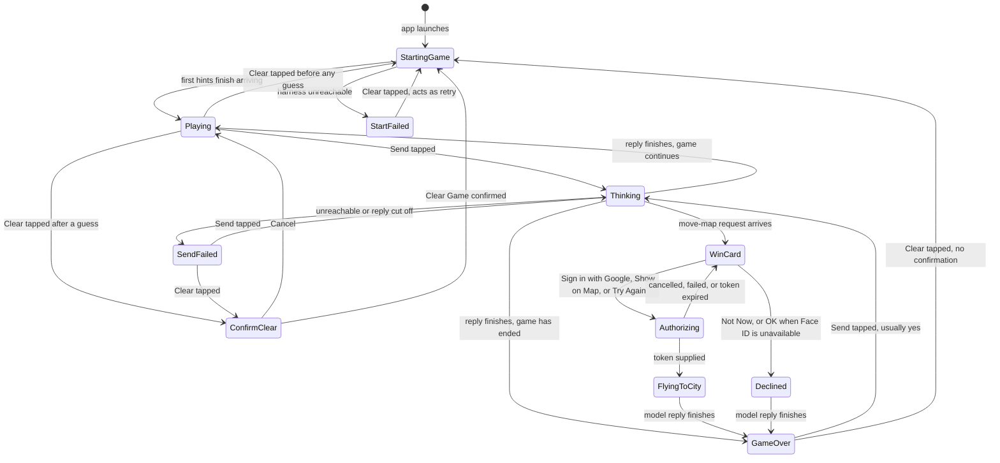

- **Send's process** covers Thinking, WinCard, Authorizing, Declined, and FlyingToCity. Clear is disabled throughout.
- **Clear's process** covers StartingGame. Send is disabled throughout.
- **Launch works like Clear without a confirmation.** The app erases the conversation, then sends the game rules, so a relaunch never resumes an old game.

###### 6.2 Launch and first game

1. The map appears immediately. If iOS hasn't asked before, the location prompt appears (wording in section 10).
2. The app erases the conversation and sends the game rules in the background. The status row shows a spinner and "Starting a game…". Send and Clear are disabled.
3. The model's opening text streams into the message area, and hint lines fill the hints area.
4. When the reply finishes, the status row clears and the helper line shows the in-play wording.

###### 6.3 Wrong guess

1. The user types "Lisbon" and taps Send, or presses return.
2. The text box empties. The status row shows a spinner and "Thinking…", the hints switch to "Previous hints" styling, and Clear is disabled.
3. When text starts arriving, the spinner stops and the status row clears. The verdict streams into the message area.
4. When the first new hint arrives, the old hints are replaced in a single cross-fade.
5. When the reply finishes, Send and Clear return to normal.

If a reply contains no recognizable hints, the old hints stay and return to normal styling.

###### 6.4 Win, including sign-in and Face ID

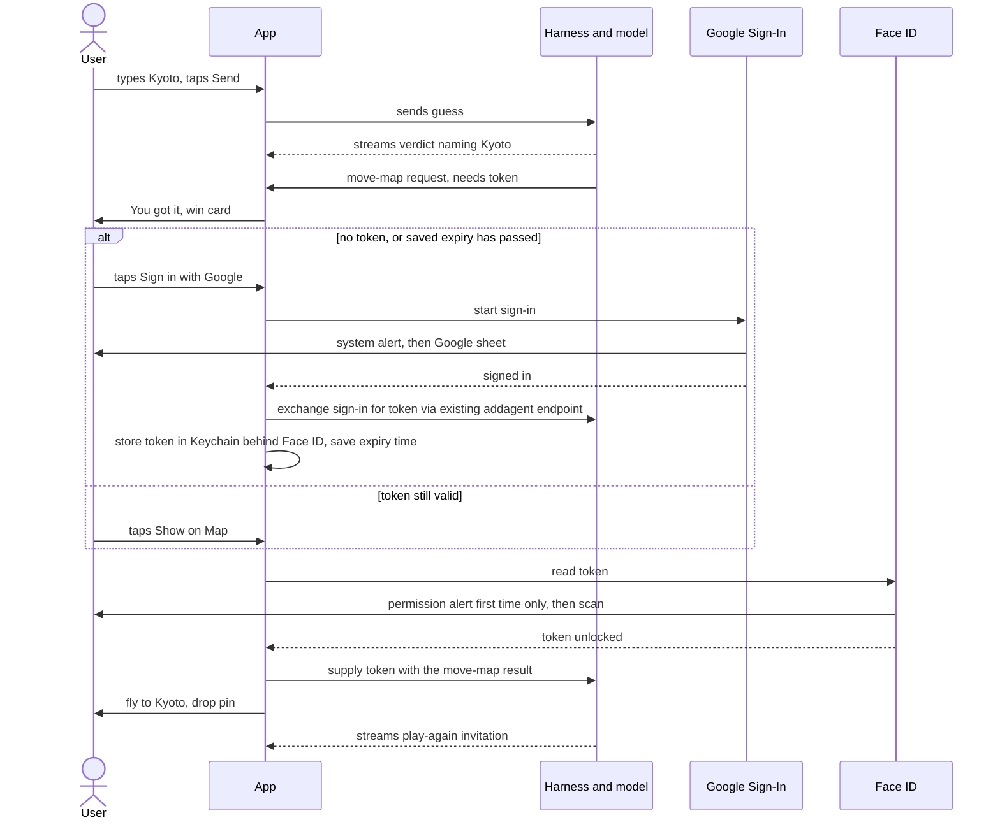

Every read of the token goes through Face ID, including the first win. This is intended. On the first win, the user sees Google sign-in and then Face ID back to back. Later wins, while the token is valid, show only the Face ID scan.

**How the card picks its wording.** The app keeps the token's expiry time as a plain, non-secret note next to it. The note reveals nothing secret, and the token itself is only ever read behind Face ID. The card checks this note, and whether Face ID is available, before showing anything.

**Step by step:**
1. When the move-map request arrives, the keyboard is dismissed and the status row shows a checkmark and "You got it!" with no spinner. The model's verdict, which names the city, stays in the message area.
2. The win card appears in one of three versions:
   - **No token, or the saved expiry has passed:** "Sign in to see the city on the map." Buttons: Google's standard **Sign in with Google** button (prominent) and **Not Now**.
   - **Valid token saved:** "Confirm with Face ID to see the city on the map." Buttons: **Show on Map** (prominent) and **Not Now**.
   - **Face ID not set up, unavailable, or locked out:** "Face ID isn't available on this iPhone, so the map can't move." Button: **OK**, which behaves like Not Now.
3. Tapping the prominent button starts the system steps. The status row shows a spinner and "Signing in…" or "Checking Face ID…".
4. Once the token is supplied, the card disappears and the status row shows "Moving the map…". The map flies to the city and the pin drops.
5. The model's play-again invitation streams into the message area, and the helper line changes to the play-again wording.

**Win card outcomes:**

| What happens | What the user sees |
|---|---|
| Sign-in or Face ID cancelled, or the scan fails | The card returns with "Sign-in didn't finish." and the buttons **Try Again** and **Not Now**. |
| The harness rejects the stored token | The card reads "Your sign-in has expired. Sign in again to see the city." with **Sign in with Google** and **Not Now**. The new token replaces the old one. |
| Not Now tapped | The card disappears and the status row reads "The map stayed put." The model is told the move was declined and finishes its reply. Its text still names the city. The game ends normally. |

Not Now does not skip the tool call. The model still makes the move-map request, and the user declines it at the approval step, as in llmHITL. Research question 3 needs this exit.

The Face ID scan reason and the one-time permission alert wording are in section 10.

###### 6.5 Win detection without a move-map request

The app treats a guess as a win only when a move-map request arrives. If the model says "Correct!" without one, the app shows the text with no checkmark, card, or map move. If the end-of-game marker (section 8) arrives, the helper switches to the play-again wording.

Moderators should note when this happens, because it means the game rules need fixing.

###### 6.6 Give up

1. The user types "I give up" and sends. It starts out like a wrong guess.
2. The model's reveal ("It was Kyoto…") streams into the message area. The hints return to normal styling and stay visible, so people can match them to the answer.
3. The map doesn't move and no sign-in happens. A give-up is not a win (R-Win).
4. The helper line changes to the play-again wording. This depends on the end-of-game marker. Without it, the helper uses the fallback wording.

###### 6.7 Play again

1. After a game ends, the user types "yes" and sends. It behaves like a normal guess. Anything else is sent as typed, and the model decides how to respond.
2. When the new game's first hints arrive, the pin is removed, the map flies back to the user's location, and the helper returns to the in-play wording.

###### 6.8 Clear

1. The user taps Clear.
   - If at least one guess has been made and the game hasn't ended, a standard system confirmation appears. Title: "Clear this game?" Message: "Your hints and guesses will be erased, and a new mystery city will be chosen." Buttons: **Clear Game** (red) and **Cancel**.
   - Otherwise, Clear proceeds without confirmation.
2. Right away, the message area and hints empty, the pin is removed, and the map flies back to the user's location. **The text box is left alone, so a half-typed guess survives.** The status row shows "Starting a new game…", Clear shows a spinner, and Send is disabled.
3. The app tells the harness to erase the whole conversation, including the rules and messages, then sends the game rules again.
4. When the first hints finish arriving, both buttons return to normal. A guess left in the text box can then be sent.

The stored token is kept.

###### 6.9 Errors

| Situation | What the user sees |
|---|---|
| Harness unreachable when Send is tapped | Status row, with a warning icon: "Couldn't reach the game. Send again." The hints return to normal. |
| Reply cuts off partway | The partial text stays. Status row: "The reply was cut off. Send again." |
| Harness unreachable at launch or after Clear | Status row: "Couldn't start a game. Tap Clear to retry." Clear acts as retry, and Send stays disabled. |

There is no automatic timeout. If a reply hangs, the moderator force-quits and relaunches the app (section 11).

##### 7. Keyboard

- Tapping the text box raises the keyboard. The panel sits above it, and the status row and messages stay visible.
- The keyboard stays up after sending, so rapid guessing is easy.
- Swiping down on the panel or tapping the map dismisses the keyboard.
- The return key is labeled "Send." It is disabled when the text box is empty. Pressing it while Send is disabled does nothing.
- The keyboard closes on its own when a win starts, so the card and the fly-to can be seen.

##### 8. What the game rules must ask of the model

The exact wording and the data markers are deferred to technical design. The rules must ask the model to:

1. Pick one real world city, keep it for the whole game, and never name it before the game ends (R-City).
2. Mark hints so the app can tell them apart from other text.
3. On a correct guess, send the move-map request with the city's position and its name.
4. When a game ends, by a win, a give-up, or a declined move, always name the city in its text.
5. Mark the end of a game so the app can switch the helper line.
6. Treat "yes" after a game as a request for a new game with a new city.
7. Recognize "I give up" and similar phrases as giving up.

##### 9. Light and dark mode, and accessibility

- **Appearance:** the panel uses the standard system frosted background, text uses system label colors, and the map follows the system appearance.
- **Dynamic Type:** all text supports it. At large sizes, the scrolling region scrolls instead of the panel growing past its cap.
- **VoiceOver:** new messages and hints are read once each, when a reply finishes, not word by word. Status changes and win card changes are announced.
- **Spoken labels:** "Send guess", "Clear game and start over", "Show my location", "Show the city on the map", "Not now". Hints shown with "Previous hints" styling are announced as "previous hints".
- **Color is never the only signal:** errors also have an icon, and the win also has a checkmark.

##### 10. Text the app writes

| Where | Text |
|---|---|
| Placeholder | Guess a city |
| Helper, during play | The city could be anywhere in the world. Type a guess, or "I give up" to reveal it. |
| Helper, after a game | Type "yes" to play again. |
| Helper, fallback if the end of a game can't be detected | Type a guess. Say "I give up" to reveal the city, or "yes" to play again. |
| Hints captions | Hints / Previous hints |
| Statuses | Starting a game… / Thinking… / You got it! / Signing in… / Checking Face ID… / Moving the map… / Starting a new game… / The map stayed put. |
| Win card | Sign in to see the city on the map. / Confirm with Face ID to see the city on the map. / Sign-in didn't finish. / Your sign-in has expired. Sign in again to see the city. / Face ID isn't available on this iPhone, so the map can't move. |
| Win card buttons | Sign in with Google (Google's standard button) / Show on Map / Try Again / Not Now / OK |
| Clear confirmation | Clear this game? / Your hints and guesses will be erased, and a new mystery city will be chosen. / Clear Game / Cancel |
| Location prompt wording | Mystery City starts the map where you are. Your location isn't used in the game. |
| Face ID permission wording (one time) | Mystery City uses Face ID to protect your sign-in before showing a city on the map. |
| Face ID scan reason | Confirm it's you to show the mystery city on the map. |
| Errors | Couldn't reach the game. Send again. / The reply was cut off. Send again. / Couldn't start a game. Tap Clear to retry. |

##### 11. Moderator setup notes

- **Face ID in the Simulator:** enroll Face ID from the Features menu, then choose a matching or non-matching face when the prompt appears. To test the "Face ID unavailable" card, leave Face ID unenrolled.
- **Resetting between participants:** Keychain items survive deleting the app.
  - In the Simulator, use Erase All Content and Settings.
  - On a physical iPhone, set the token lifetime shorter than the gap between sessions so each participant starts signed out.
  - In both cases, sign the test Google account out in Safari and reset location permission.
- **If a reply hangs:** force-quit and relaunch. Launch starts a fresh game.
- **Before testing:**
  - Confirm the harness waits long enough for a slow sign-in.
  - Run one full win to check that the game rules produce hints, the end-of-game marker, and the move-map request.

##### 12. Deferred to technical design

- How the app connects to the harness: streaming method and request and response shapes, using only the existing tutorial endpoints plus `/llmclear`. The token exchange uses the existing llmHITL `/addagent` endpoint. No harness API changes and no harness login.
- How hints, the end-of-game marker, and other text are marked in the data.
- The exact move-map request format and how a token or a refusal is sent back.
- The exact game rules text.
- Google Sign-In library and client setup.
- Token lifetime, and where the non-secret expiry note is kept.
- Minimum iOS version and the matching frosted-panel and map features.
- Code structure and naming, which must follow the llmTools and llmHITL tutorials.

##### 13. Settled decisions

1. Face ID guards every token read, including the first win.
2. The Clear confirmation stays.
3. The sign-in gate stays at the win, because people's reactions to it are research question 3.
4. The helper line and the locate-me button stay. The Tried row and the "Reset sign-in" switch are dropped.
5. Clear never empties the text box.

**Elephant's closing challenge:** One challenge before you lock this in. Dropping the reset switch makes resetting a physical iPhone between participants awkward. The workaround in section 11 is a short token lifetime, but a short lifetime could cause a token to expire between a participant's two wins, which would muddy the "second win, Face ID only" step. Are you running sessions on the Simulator or on real iPhones?

**My answer:** Sessions run on the iPhone Simulator, so Erase All Content and Settings resets between participants; no short-lifetime workaround needed.


---

<a id="goldfish-1-rounds"></a>
## Goldfish 1 Rounds (UX clarity audit)

### Round 1 (audited E-A v1)
#### Audit of Exhibit E-A: Mystery City

The attached document isn't labeled "Exhibit E-A" and the paste placeholder was left in, so I'm treating the attached spec as E-A.

The spec describes one screen drawn by the app. At the winning moment, though, system sign-in and Face ID sheets take over, so in practice the user sees two experiences. I've audited both.

---

##### Screen 1: The game screen (map plus bottom panel)

**1. Purpose and value**

You read text hints and type the name of a city until you get it right. The value is a quick, low-effort puzzle, with the map as a reward when you win.

**2. Most obvious interactive element, and what happens when tapped**

The most obvious element is the map. It fills the entire screen, and you can pan and zoom it. This is the core problem with the screen.

In a game called "Mystery City," a full-screen map strongly suggests you play by tapping on the map. If a user taps it, nothing game-related happens. At most the keyboard goes away. The real primary control is a single-line text box at the bottom. On launch, it sits next to a dimmed Send button and a dimmed Clear button, under a spinner.

The transition isn't confusing, because nothing happens. That's the failure. The biggest element on screen is a decoration you can play with, and the game itself lives in a strip at the bottom.

**3. Top 3 elements by prominence**

1. **The map**, centered on the user's own neighborhood, with a blue location dot.
2. **The hints text** in the panel.
3. **The text box and Send button.**

This order doesn't match the purpose. The purpose is "read hints, type a guess," so hints and the input should rank first, and the map should be background until you win.

It's worse than wasted space. Opening on the user's own neighborhood actively misleads. People will assume the mystery city is nearby, or that their location matters to the game. It doesn't. The location permission prompt, the very first thing a test participant sees, asks for something the game never uses. That prompt will color every session.

**4. Confusing, ambiguous, or poorly placed**

- **"Clear" doesn't mean what it says.** Everyone reads "Clear" next to a text area as "empty the text box." Here it wipes the whole game with no confirmation, and it is the one thing that does *not* empty the text box ("Any text in the text box stays"). It's also placed on the turn line, right next to the last guess, so it reads as "clear this guess." Expect participants to lose games by accident and not understand why. Call it "New game."
- **The turn line is overloaded.** One line of up to three rows carries your last guess, the verdict, spinners, status messages, the model's opening text, the give-up reveal, error messages, and the map-failure note, all while sharing its width with the Clear button. A three-row cap with no rule for overflow means long verdicts or reveals will be cut off at exactly the moments that matter.
- **No memory of the game.** Only your *last* guess and the *current* hints are shown, and old hints are swapped out. Users will forget what they already tried and repeat guesses. They also can't compare earlier clues against new ones.

A note on your second research question: "give up" is printed word for word in the helper line. Finding it tests whether people read small gray text, not whether the feature is discoverable. Decide whether that's the question you actually mean to ask.

---

##### Screen 2: The winning moment (sign-in and Face ID takeover)

**1. Purpose and value**

It confirms the correct guess and shows the mystery city on the map as a reward. The value is the "aha" payoff.

**2. Most obvious element, and what happens next**

The most obvious element is a system alert that the user didn't ask for, roughly "Mystery City wants to use google.com to sign in." The only warning is a status line, "Signing in to show it on the map…", which appears a split second before the alert covers the screen.

If the user taps Continue, they get a Google account sheet, and then the map flies to the city. If they tap Cancel, the reward is gone for good. There is no retry, and the turn line says "The map couldn't move because sign-in didn't finish."

This transition is very ambiguous. Nothing explains why a guessing game needs a Google account to move a map. A cautious user will reasonably cancel, and the design then punishes them for it.

**3. Top 3 elements by prominence**

1. **The system sign-in alert or Face ID prompt**
2. **"You got it!"** in the turn line
3. **The map fly-to and pin**, but only after authentication

The order is backwards. The reward should come first, and any gate should come after it, or not at all. As designed, the celebration is interrupted by a security check, and a returning winner faces a *second* prompt on their next win (the one-time "Allow Face ID?" request).

**4. Confusing, ambiguous, or poorly placed**

- **The gate has no explanation and no way back.** The cancel path is final, and the failure message reads like it blames the user. At minimum, add a "Show on map" retry. Better still, show a one-line explanation *before* the system alert.
- **Giving up and winning behave inconsistently.** Giving up reveals the city but never shows it on the map. Users who give up are the ones most curious about where the city is.
- **The map stays put into the next game.** After a win, the map remains on the old city with no reset. Players may read the visible region as a hint for the new round, or think the old answer is still in play.

---

##### Can this app be built from the spec without questions?

No. The visual and interaction layer is unusually thorough. The data contract that everything depends on is missing, and the spec points to documents that weren't supplied. Gaps and questions:

**Missing references and undefined contracts**
- "Challenge 1" and "Requirement 3d" are referenced but not included. What do they say?
- What is the "harness"? Is it HTTP streaming, Server-Sent Events, or WebSocket? What are the endpoint, the request and response shapes, and the authentication?
- What exactly are the "game rules" sent at launch? Who owns that text?
- What is the hint format? "Recognizable hints" is never defined. How do I tell hints, the verdict, a reveal, and other text apart in the stream?
- Does the end-of-game marker exist yet? The helper line's behavior depends on it.
- What is the tool call's exact format (name, arguments, whether the city name is included), and how do I return a result or a refusal?
- How is a win detected? Is it only by the tool call? What if the model says "Correct!" but never sends one?

**Authentication**
- Which Google Sign-In SDK and client ID? What endpoint does "register, receive token" use, and what does it return?
- What is a "valid" token? How are expiry and refresh handled, and what if Face ID unlocks a token the harness then rejects?
- What happens on devices with Face ID unavailable, not enrolled, or locked out after failed attempts? Is there a passcode fallback?
- The one-time Face ID permission alert needs its own Info.plist wording, separate from the reason line. What should it say?
- What if the app goes to the background mid-sign-in, or the 2-minute harness wait expires?

**Logic contradictions**
- In the "reply cut off" error, the text says "Tap Send to try again," but the text box was emptied on send, and Send is disabled when the box is empty. Is the guess restored?
- The state diagram has no paths for Clear from the failed-send state or from the waiting state. Is that intentional?
- After the map move is approved, if the move itself fails (spec 4: "refused or failed"), what text appears?
- In the game-over state, what happens if the user types anything other than "yes," such as another guess or "no"?
- "You got it!" is app-written, and then the model's text streams into the same line. Does it replace it or append?
- The turn line caps at three rows. Should longer text be truncated, scroll, or expand?

**Layout and platform**
- What is the panel's height cap when the keyboard is up? On an iPhone SE, the keyboard plus a 40% panel leaves almost no map.
- Is iPad supported? Is landscape?
- What is the minimum iOS version? It affects which frosted materials and map APIs are available.
- What is the location permission purpose string? Why ask for location at launch rather than when locate-me is tapped?
- The "Reset sign-in" switch requires a Settings bundle. Should it ship in test builds only?

**Product decisions**
- Why does showing the map require sign-in at all? If it's only there to test reactions, say so, because it changes how I'd build the cancel path.
- Should there be a guess history?
- Should a give-up move the map?

> Goldfish 1 was stopped after Round 1. Its remaining concerns were back-end questions deferred to E-B, and the E-A v2 revision was then audited for requirements coverage by Goldfish 2.

---

<a id="goldfish-2-rounds"></a>
## Goldfish 2 Rounds (requirements coverage audit)

### Round 1 (audited E-A v2)
#### Audit of Exhibit E-A v2: Mystery City UX Specification

**Overall verdict:** Exhibit E-A covers every stated requirement, and most of its choices follow Apple's guidelines. The problems fall into three groups:

- a few places where the spec quietly stretches or risks breaking a requirement,
- some layout choices that undercut the "map is the hero" preference,
- a noticeable amount of extra polish and error handling that a usability prototype doesn't need.

##### Gaps and risks against the design requirements

- **The token exchange may need a harness change that isn't allowed.** The win sequence has the app "exchange sign-in for token" with the harness. The requirements say the harness API cannot change except for `/llmclear`. The spec puts this under "deferred" and even mentions "any harness sign-in." It should state that the exchange either uses an existing tutorial endpoint or happens entirely on the iPhone.
- **The win card can't know if a token is valid without reading it.** The card picks between "Sign in with Google" and "Confirm with Face ID" before any Face ID check. But every token read must go through Face ID. So expiry information must sit somewhere unprotected, or the card wording will sometimes be wrong. The spec should say which.
- **"Send's process" is stretched to cover waiting on the user.** Send keeps its spinner, and Clear stays disabled, while the win card is just sitting there. This can go on indefinitely if the user never taps a button. The spinner then claims something is in progress when nothing is, which breaks the spec's own rule that the app "says only what it knows."
- **Compliance with the architecture baseline can't be checked.** Matching the llmTools and llmHITL tutorials, SwiftUI, and MapKit is all deferred or only implied. The spec never names SwiftUI or MapKit, and never shows how its flows map onto the tutorials' tool-call and approval steps.
- **"Not Now" lets the user skip the required tool call.** The requirement says a correct guess triggers a tool call that re-centers the map. Not Now ends the game with no map move. The spec should say whether a declined move still counts as satisfying the requirement, or whether this is purely a research choice.
- **The state diagram leaves out several paths described elsewhere:**
  - an expired or rejected token,
  - the map failing to show the city,
  - the harness timing out on a win,
  - the app going to the background during sign-in.

  The Face ID–unavailable path also skips the "OK" step the table describes.
- **The status row can't both keep a fixed height and grow to two lines for errors.** Either it always reserves two lines, wasting space when blank, or the panel jumps when an error appears.
- **The return key can't fully follow Send's states.** iOS can automatically disable the return key when the text box is empty. It has no standard way to show a "busy" state while a reply is in progress. The spec should say what happens if return is pressed mid-reply.
- **Clear also wipes the user's half-typed guess.** The requirement covers conversation history, not the text box. Throwing away a draft the user is still typing is unexpected and isn't asked for.

##### Look-and-feel and Apple guideline conflicts

- **The map is often barely visible.** The panel can take up to about 45% of the screen. With the keyboard up, the spec admits "very little map shows" on small iPhones. That conflicts with "the map is the hero" and "the map is always visible."
- **The panel is not "clean and minimal."** The preference names four things for the panel: hints, text box, Send, and Clear. The spec adds three more regions: a status row, a message area, and a win card. The Tried row and helper line, also listed in the panel, are flagged under added features below. Together these crowd the panel and push it taller.
- **Clear's touch target isn't specified.** Send is promised at least 44 by 44 points, but Clear is described only as a "small text button." The same gap applies to the tappable "Location is off" capsule. Apple's minimum applies to both.
- **Send and Clear don't match.** Send is an SF Symbol and Clear is a text label, though the look-and-feel asks for SF Symbols. A text label is acceptable under Apple's guidelines, but the mismatch should be a deliberate choice.
- **Dimming old hints to about 40% will likely fail contrast**, especially over a translucent panel on a busy map in light mode. Apple's guidelines expect text to stay readable.
- **Google sign-in prompts break the "no full-screen interruptions" rule.** The system alert and Google sheet are unavoidable, and the spec only partly acknowledges this. The research plan should note that this step is intentionally the exception.
- **The "Show on Map" button may not meet Google's branding rules.** It starts Google Sign-In without Google's branding. This is fine for a prototype, but participants may not realize they're about to sign in with Google.

##### Features added beyond the requirements

- **The Tried row** (app-recorded guess history) isn't required and doesn't serve any of the four research questions.
- **The helper line** isn't required. The spec admits it shapes research question 2, measuring willingness rather than discovery.
- **The Clear confirmation dialog** isn't required. Apple's guidelines support confirming destructive actions, but the spec's own open question 13.1 notes the dialog interferes with observing accidental clears.
- **A locate-me button and a "Location is off" note linking to Settings** go beyond the requirement to center on the user at launch. They are guideline-friendly but optional.
- **A red pin with the city's name and a success haptic** are extra polish the requirements don't ask for.
- **The "Reset sign-in" switch in the Settings app** is new built test tooling. Moderators could reset by other means.
- **Reliability hardening beyond what a prototype needs:**
  - stall detection with timeouts,
  - restoring the guess and removing its Tried capsule after a failure,
  - recovery after the app goes to the background mid-sign-in,
  - handling the harness timing out on a win,
  - deleting rejected tokens.

  The requirements say there is no reliability hardening, so these should be trimmed or justified as needed for the test sessions.
- **"Any harness sign-in"** in the deferred list hints at adding login to the back end. That is unrequired account and security work and should be ruled out.

---

<a id="exhibit-e-b"></a>
## Exhibit E-B — Technical Proposal (extends llmHITL)

### Elephant prompt used
Phase 2 Elephant prompt (fresh session): the required Rensin framing, Principal Software Engineer role, the spec's first-draft request verbatim, constraints (tutorial structure and naming; no API, data-format, or schema changes beyond /llmclear; interoperability), plus Design Requirements, E-A v3 FINAL, and a structural summary of the llmHITL code base.

### E-B v1 (Elephant's first draft)
#### Mystery City: First-Draft Technical Proposal

Before the draft, I want to challenge one assumption, because it may break a constraint you consider fixed.

**The "no back-end change" constraint and the new tool may conflict.** Your summary says the harness's tool registry (toolbox.py) is loaded from tool definition files on the server, and that `_checkAuth` runs there. If the move-map tool has to be registered on the server, then:

- my back end needs a new tool file. You could argue that's configuration rather than an API change.
- **my app will not work against the course back end**, because the course harness doesn't know the move-map tool exists.

If instead the tutorial lets the front end declare its own tools in each request, the problem goes away. I've written the draft assuming the second case and flagged it below. I need you to tell me which one is true, because it's the single most important fact in this design.

##### 1. The shape of the solution

The app is the llmHITL front end with a different screen and one new on-device tool. Everything game-specific lives in two places:

- **The game rules text**, which tells the model how to behave and how to mark its output.
- **The view model**, which reads the model's output and decides what goes where on screen.

The harness doesn't know it's running a game. It passes messages, stores history, checks tickets, and erases history on request, exactly as it does today.

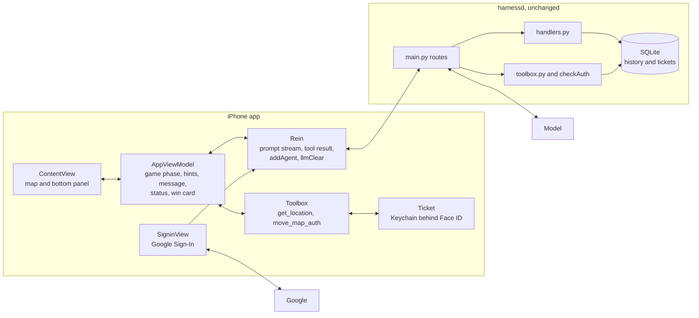

##### 2. Front-end pieces, mapped to the tutorial

I'm keeping every tutorial file name and its responsibility. The changes are as follows.

| File | Responsibility (unchanged) | What changes for Mystery City |
|---|---|---|
| ContentView | The one screen | Becomes a full-screen map with the translucent bottom panel. It covers the status row, message, hints, win card, text box, and helper line. It has no navigation. |
| AppViewModel | All UI state | Holds one "game phase" value that mirrors the spec's state diagram. Every Send/Clear enable rule, status line, and helper line is derived from that phase, never set separately. It also splits the model's text into message and hints. |
| Rein | Talking to the harness | No new endpoints. It uses the existing prompt stream, tool-result return, `addAgent`, and the Project 1 `llmClear`. |
| Toolbox | On-device tools | Gains one tool, move_map_auth. The name follows the tutorial's "_auth" suffix convention for authorized tools. Its handler pauses and waits for the human decision before returning a result. |
| Ticket | The ticket singleton in the Keychain behind Face ID | Unchanged, plus one small addition: a non-secret expiry note readable without Face ID. The win card needs it to pick its wording. |
| SigninView | Google Sign-In | Reused, but it shows up as the Google button inside the win card, not as its own screen. The spec forbids app-drawn sheets. |

**The map** is SwiftUI's built-in map with the camera position owned by the view model. Three things move the camera: launch (user location), the win (city), and a new game (back to the user). Keeping that in one place stops the "who moved the map" bugs.

##### 3. Carrying the game through an unchangeable data format

Since the data format is fixed, the game's structure must ride inside the model's ordinary text. The rules ask the model to put special items on their own lines:

- each hint on a line starting with a fixed hint prefix,
- a secret line naming the city in its first reply (more on this below),
- an end-of-game marker line when a game finishes.

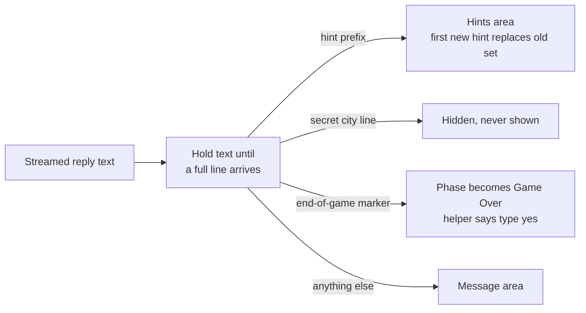

Holding text until a line is complete matters. If the app showed words as they arrived, the secret line would flash on screen before the app recognized it.

**Why there is a secret line at all.** The model has no memory between turns except the stored conversation history. If it "picks" Kyoto silently, nothing records that choice. Next turn it sees only its earlier hints, and it may quietly settle on a different city that fits them. Writing the city into its own first reply puts it into the stored history, which keeps it fixed for the session (R-City). The app hides that line from the user.

##### 4. The win, with the approval step

This is the llmHITL pattern with a human pause inserted in the middle.

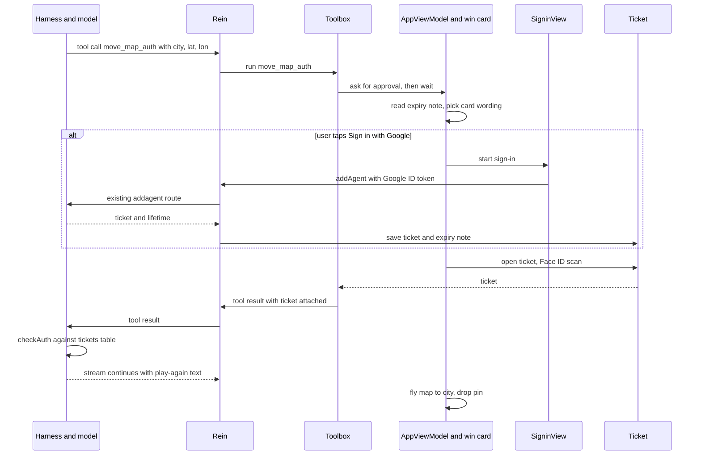

**Not Now** sends the tool result back with no ticket and a "declined" note. The harness's existing auth check refuses it, and the model is told the call failed and finishes its reply naming the city. That follows llmHITL without inventing a new refusal path, assuming a refusal lets the model continue rather than ending the stream (see decision 3 below).

##### 5. Launch and Clear

These are the same sequence; only the trigger and the confirmation differ:

1. Call `llmClear`.
2. Send the game rules as the first prompt.
3. Stream the opening reply.

The Ticket and its expiry note are never touched by Clear.

##### 6. Decisions I'm least sure about

1. **Where the move-map tool is declared.** If it must be a server-side tool file, the "my app works with the course back end" constraint fails. Do we accept that, or is there a client-declared path?
2. **When the map moves.** I placed the fly-to after the harness accepts the ticket, so an expired ticket shows "Your sign-in has expired" instead of a map that moves and then gets un-approved. That depends on the app being able to tell "accepted" from "refused" in the stream. If it can't, the alternative is moving the map immediately on Face ID success and accepting a rare mismatch. That's simpler but technically dishonest.
3. **How the harness reports a refused authorized call.** If it ends the stream with an error instead of telling the model, Not Now will look like a crash, not a graceful decline. This needs testing on day one.
4. **Ticket lifetime.** The tutorial uses 180 seconds, so the "second win with Face ID only" in your test script will almost certainly hit an expired ticket. The script needs something like 15 to 30 minutes. Is changing that number in handlers.py allowed? It's not the API or schema, but it is the back end.
5. **Where the expiry note lives.** I lean toward ordinary app settings rather than a second Keychain item. Settings are wiped when the app is deleted, while the Keychain isn't, so deleting the app makes each participant start at "Sign in." That helps your moderator reset. The cost is a stale ticket lingering in the Keychain until it's overwritten.
6. **Text markers versus tools for hints and end-of-game.** Markers are cheap but depend on the model obeying formatting. Separate tools such as show_hints and end_game would be far more reliable, but they add round trips and run into the same registration problem as decision 1.
7. **Trusting the model's coordinates.** Models misremember latitude and longitude, so a map that flies to the wrong place would undermine the reward. The app could look up the city name with Apple's own search and use the model's numbers only as a fallback. That arguably bends "re-center to the lat/lon from the tool call."
8. **Does the secret city line violate R-City?** It's hidden on screen but visible in network traffic and the database. For a usability prototype I think that's fine, but you should decide that consciously.

##### 7. Questions for you

1. In the tutorial, does the app declare its tools in each request, or does the harness only know tools from its own files?
2. What does `/llmclear` erase? Is it just this device's conversation, or the whole history table? Does it touch the tickets table? On a shared course back end, a table-wide wipe would erase other people's sessions.
3. Can the tutorial send a true system-role message, or only user messages? R-Clear talks about clearing "system" prompts, and I'm assuming the rules go in whatever slot the tutorial already offers.
4. Which model does the harness run? Smaller local models are noticeably worse at both tool calls and strict line formatting, which changes how hard I'd push on decision 6.
5. Does the Simulator path in Ticket bypass the Secure Enclave? If so, sessions run in the Simulator aren't testing the security behavior the requirement describes. That may be fine for usability research, but it should be stated in the test plan.

### My pushback (debate round 1)
1. Hiding the city: the city must stay fixed but hidden. If it only lives in the model's context, what stops the model from drifting to another city mid-game? Should the rules make it commit (e.g. state it in a hidden/system part) — and does that risk leaking it to the user?
2. Hints parsing: if hints are marked with plain-text markers in the stream, what happens when the model forgets the marker or a marker splits across two stream chunks? Defend your choice vs. asking for the whole reply as JSON.
3. The re-center tool: confirm it's an on-device tool registered the same way as get_location in llmTools, with a tool JSON on the back end like get_weather_auth.json, and that _checkAuth validates the ticket. Where exactly does the front end attach the ticket?
4. Expired ticket: the front end thinks it's valid (saved expiry), but the harness rejects it. Walk me through the exact recovery without changing the API.
5. Clear: /llmclear wipes server context — what happens if Clear is tapped while a tool call is pending? Is that even possible given Send disables Clear?

### Elephant's answers
Here are short answers to your five points, then the full revision.

1. **Hiding the city.** I agree the model must commit, but there's no hidden system channel the model can write to. The app can't write the city into the rules because it doesn't know the city. The only place the model can commit is its own reply, which the harness stores. I've strengthened the draft: the model restates the city on a hidden line at the top of every reply, the app checks for drift, and a leak guard holds back any visible line that names the city early.
2. **Hint markers.** A marker split across stream chunks can't cause a problem, because the app never sorts text until it has a whole line. A forgotten marker degrades gracefully: one line lands in the wrong area. Asking for JSON fails worse, since one missing bracket loses the whole reply, and it also blocks progressive display.
3. **The re-center tool.** I can confirm this only against your summary, not the tutorial code. There's one real gap. The tutorial has a device-run tool (get_location) and an authorized tool (get_weather_auth), but move-map would be both at once. Whether `_checkAuth` runs on results coming back from the device is the first thing to verify.
4. **Expired ticket.** The exact recovery is spelled out in section 7. It uses only the existing tool-result route, the existing `/addagent`, and one hidden follow-up prompt.
5. **Clear during a pending tool call.** This can't happen through the normal screen. It can happen through the error path and through force-quit and relaunch, which is the moderator's documented recovery. That's a real race, covered in section 8.

### E-B v2
#### Exhibit E-B v2 — Mystery City: Technical Design (Draft, Revision 2)

Supersedes E-B v1. Companion to Exhibit E-A v3. Usability prototype only.

##### 0. What changed from v1

- The city is restated on a hidden line in every reply, not just the first. The app checks it for drift and holds back early leaks.
- Reply reading is defended against split chunks and forgotten markers. JSON is rejected, with reasons.
- The move-map tool is registered like the tutorial tools, and the exact place the ticket is attached is named.
- An exact recovery path is defined for a ticket the app thinks is valid but the harness rejects.
- Clear is guarded against tool calls left hanging after errors or relaunch.

##### 1. Shape of the solution

The app is the llmHITL front end with a new screen and one new tool. The harness code is unchanged. It passes messages, stores history, checks tickets, and erases history. Everything game-specific lives in two places:

- the game rules text, which tells the model how to behave and how to mark its output,
- AppViewModel, which reads the model's output and decides where each part goes on screen.

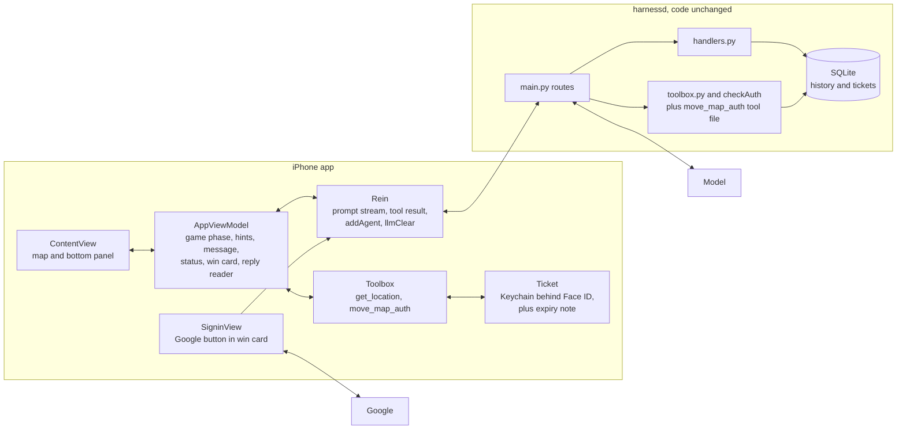

##### 2. Front-end pieces

Names and responsibilities follow the tutorials. No new files are added.

| File | What it does in Mystery City |
|---|---|
| ContentView | Full-screen map plus the bottom panel from E-A v3. It holds no game logic. |
| AppViewModel | Owns one game phase value that mirrors the E-A state diagram. Every Send and Clear rule, status line, and helper line comes from that phase. It also contains the reply reader (section 5), the leak guard (section 4), and a game number used to drop stale replies (section 8). |
| Rein | Unchanged. It uses the existing prompt stream, the existing tool-result route, addAgent, and llmClear. |
| Toolbox | Gains move_map_auth. Its handler waits for the human decision, reads the ticket, attaches it, and returns the result. |
| Ticket | Unchanged, plus a non-secret expiry note kept in ordinary app settings so the win card can choose its wording without Face ID. |
| SigninView | Reused as the Google button inside the win card, not as its own screen. |

##### 3. Back end

- **No code, API, data-format, or schema changes.** The only endpoint beyond the tutorials is `/llmclear`.
- **One new tool definition file, move_map_auth.** It follows the same pattern as get_weather_auth.json and is loaded by the existing tool registry. It marks the tool as run on the device, like get_location, and as needing a ticket, like get_weather_auth. It is data, not code.
- **Consequence:** my app works against the course back end only if that back end also has this file. This needs to be confirmed with course staff.
- **Ticket lifetime:** the tutorial's 180 seconds is too short for the test script's "second win with Face ID only." I propose 20 minutes. That's a constant in the back end, not the API or schema, and it still needs your approval.

##### 4. Keeping the city fixed and hidden

**The problem.** The model remembers only what is in the stored conversation. If it picks a city silently, nothing records the choice, and later turns can drift to another city that fits the hints given so far.

**Why there's no hidden system slot.** The app can't put the city into the rules, because the app doesn't know it. The model chooses it (R-City). So the only place the model can commit is its own reply, which the harness stores in history.

**The design:**

- **Commit line.** Every reply begins with one secret line naming the city, for example "[secret: Kyoto]". The first reply commits the city. Repeating it in later replies keeps it fresh in the model's attention and gives the app something to check each turn.
- **Hiding.** The reply reader removes secret lines before anything is displayed. Because the reader works on whole lines (section 5), the secret line never flashes on screen.
- **Drift check.** The app remembers the first committed city. If a later secret line, the city in the move-map request, or the city named in a give-up reveal doesn't match, the app writes a moderator log entry. The player sees nothing different, but the session is flagged.
- **Leak guard.** Any visible line that names the committed city is held back until the reply finishes. It is shown if any of these is true:
  - the reply ended the game (a move-map request or the end-of-game marker arrived),
  - the player's latest guess named the city.

  Otherwise the line is dropped and logged. This catches the model blurting the answer in a hint or a verdict.

**Remaining leak risks, accepted for a prototype:**

- The city is visible in network traffic and in the SQLite history.
- If the model ignores the secret-line format and names the city in a normal sentence, only the leak guard stands between that sentence and the screen.

##### 5. Reading the model's reply

**Markers.** Each special item sits on its own line:

- **Hints:** each hint starts with "Hint:".
- **Secret:** the secret line described in section 4.
- **End of game:** a final line reading "[game over]".
- **Refusal:** a line reading "[map refused]" (section 7).

**Rule 1: only whole lines are sorted.** Streamed text is held until a line ends, or until the reply ends. A marker split across two chunks is therefore impossible to misread, by construction. The cost is that text appears one line at a time instead of one word at a time, which is acceptable.

**Rule 2: be forgiving about form.** Markers are matched without regard to capital letters, leading spaces, bullet characters, or bold styling, because models add these freely.

**Rule 3: a forgotten marker degrades gracefully.**

| Forgotten marker | What happens |
|---|---|
| Hint prefix | The line lands in the message area. Old hints stay and return to normal styling, as E-A v3 section 6.3 already specifies. |
| End-of-game marker | The helper line uses the fallback wording from E-A section 10. |
| Secret line | The drift check logs it, and the leak guard still protects the screen. |

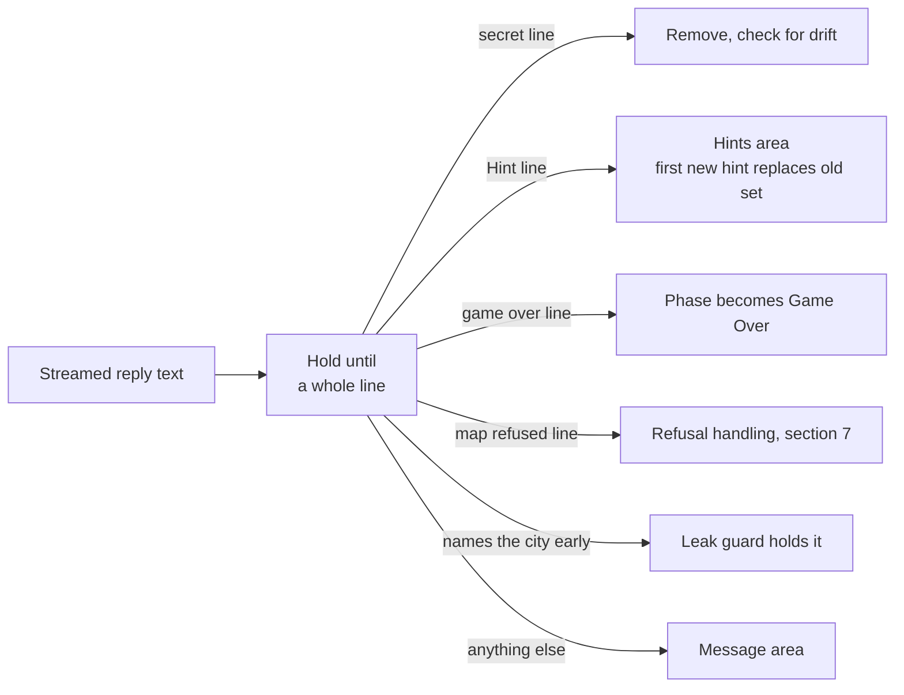

**Why not ask for the whole reply as JSON:**

- **No progressive display.** A JSON reply can't be shown until it's complete, unless we write a partial-JSON reader. E-A requires text to stream in.
- **Worse failure.** One missing quote or bracket makes the whole reply unreadable, so the player sees nothing. Markers lose one line at most.
- **No enforcement available.** The harness can't be changed to switch on the model's "JSON only" mode, so we'd be relying on the model's obedience either way.
- **Messy alongside tool calls.** A JSON body mixed with a tool call in the same turn is awkward.
- **What JSON would buy:** one clear structure and easy checking. That isn't worth the costs above for a prototype.

##### 6. The move-map tool and the ticket

- **Registration.** move_map_auth is defined in a back-end tool file following get_weather_auth.json, and run on the device like get_location.
- **Arguments.** The model sends the city name, latitude, and longitude.
- **Where the ticket is attached.** Inside the move_map_auth handler in Toolbox, after the human approves:
  1. Toolbox asks Ticket to open the ticket, which triggers Face ID.
  2. Toolbox attaches the ticket to the tool result in the same place the tutorial's Toolbox attaches it for get_weather_auth.
  3. Rein posts that result on the existing tool-result route.

  The ticket is never placed in prompt text.
- **Where it's checked.** The harness's `_checkAuth` looks up the ticket in the tickets table when the result arrives.
- **Gap to verify on day one.** In the tutorial, the device-run tool and the authorized tool are different tools. If `_checkAuth` runs only before server-run tools and not on results returned from the device, the check never happens for move_map_auth. In that case R-Token can't be met without a back-end change, and this must be escalated before any other work.
- **When the map moves.** The map moves only after the harness accepts the ticket. The app learns this from the first line of the model's continuation, ignoring secret lines:
  - If that line is the refusal marker, the ticket was rejected (section 7).
  - Otherwise the app flies to the city and drops the pin.

  The status row reads "Checking Face ID…" until then. If the harness turns out to give the app a direct refusal signal, the app uses that instead of the marker.
- **Not Now.** Toolbox posts the tool result with no ticket. The harness refuses it, and the model sees a refusal. The rules tell the model to treat any refusal as a decline: name the city and end the game. The app knows it sent no ticket, so it reads that refusal as the expected decline and shows "The map stayed put."

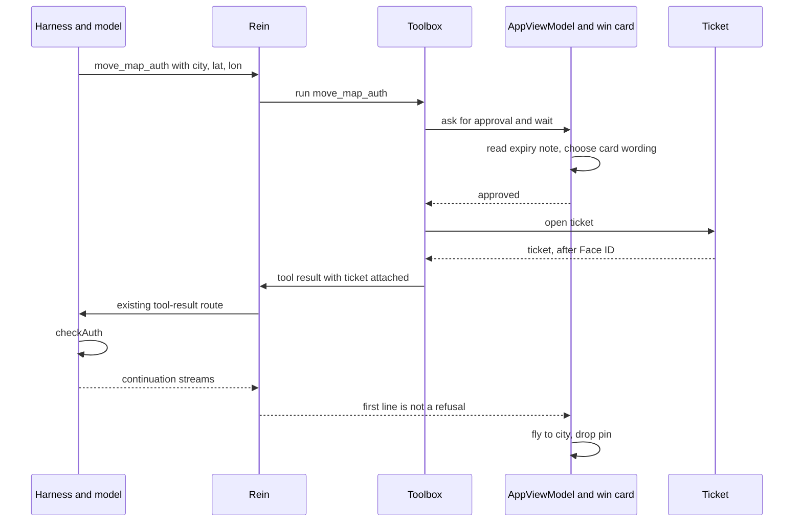

##### 7. Recovering when the harness rejects a ticket the app thinks is valid

**Prevention.** The expiry note is computed from the lifetime the harness returns, counted from when the app received it. The app treats the ticket as expired 30 seconds early. This reduces rejections but can't remove them: the harness may have lost its tickets, or `/llmclear` may erase them.

**Main path, assuming the refusal goes to the model and the tool call is used up:**

1. The win card shows "Confirm with Face ID". The player taps Show on Map, passes Face ID, and the ticket is attached and posted.
2. `_checkAuth` rejects it. The model's continuation begins with the refusal marker, then names the city and ends the game, as the rules require.
3. Because the app sent a ticket, it reads the refusal as an expiry, not a decline. The app:
   - deletes the stored ticket and expiry note,
   - does not move the map,
   - shows the card "Your sign-in has expired. Sign in again to see the city." with Sign in with Google and Not Now.

   The model's text keeps streaming into the message area. It names the city, which the player already guessed, so nothing leaks. Send and Clear stay disabled while the card is up.
4. **If the player taps Not Now:** the card closes, the status reads "The map stayed put.", and the game is over. Nothing more is sent.
5. **If the player taps Sign in with Google:**
   1. Google Sign-In runs. addAgent posts to the existing `/addagent`, and a new ticket and expiry note are saved.
   2. The app sends a hidden follow-up prompt on the existing prompt route: "The player signed in again. Send the move-map request again for the same city." The screen never shows player prompts, so the player doesn't see it.
   3. The model sends a new move_map_auth request. The app knows the player has just approved, so it skips the card, shows "Checking Face ID…", runs Face ID, and attaches and posts the new ticket.
   4. When the first line is not a refusal, the map flies and the pin drops. The model's short play-again line streams in.
6. **If the new ticket is also rejected:** the app allows only one re-sign-in per win. The card closes, the status reads "The map stayed put.", and the event is logged for the moderator.

**Alternate path, if the harness instead reports the refusal to the app and keeps the tool call waiting:** after the new sign-in, Toolbox simply posts the tool result again with the new ticket. No hidden prompt is needed. Day-one testing decides which path is real.

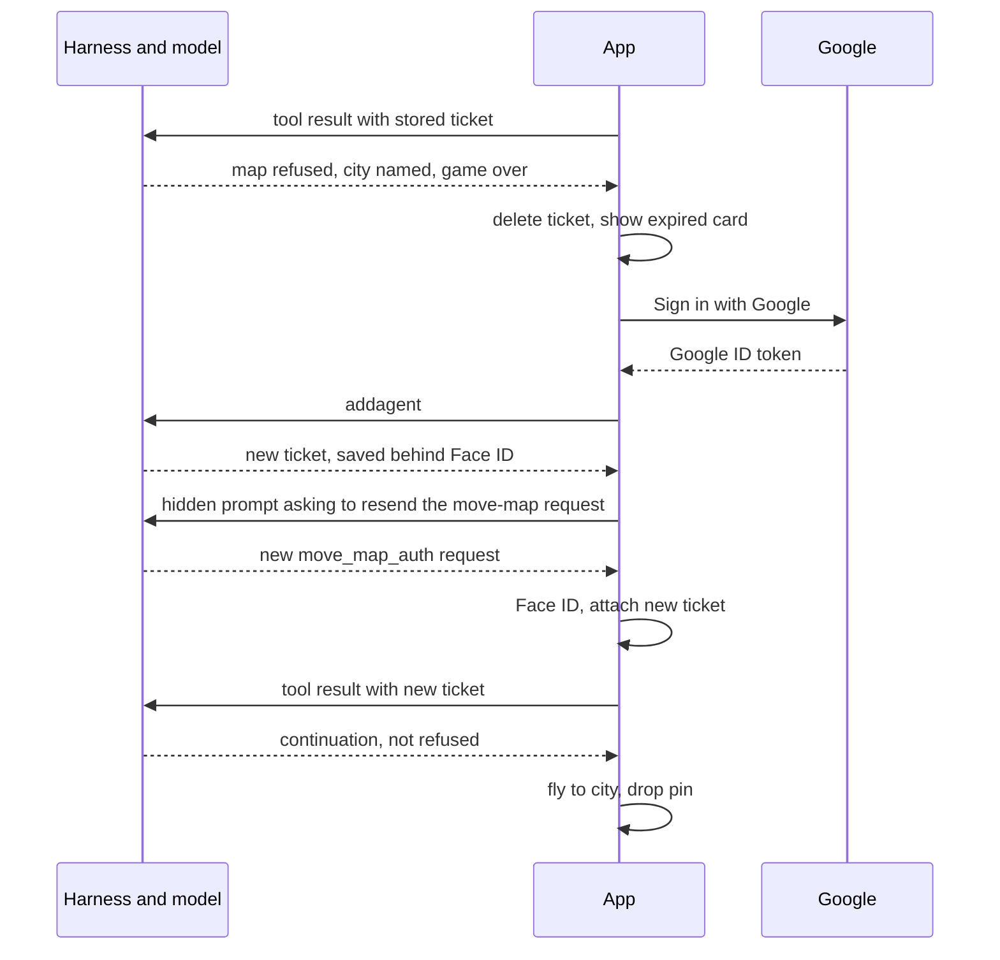

##### 8. Clear, launch, and tool calls left hanging

**Through the normal screen, it can't happen.** Clear is disabled for all of Send's process, from Thinking through the end of the approval step.

**It can happen in two other ways:**

- **The error path.** If the stream drops after the harness has issued a move-map request, the app shows "The reply was cut off" and re-enables Clear. The harness may still be waiting for that tool result.
- **Force-quit and relaunch.** This is the moderator's documented fix for a hang. Launch runs `/llmclear` while the harness may still be holding the old turn.

**The risk.** If the harness writes the old turn into history after the erase, pieces of the old game, including its secret city, land in the new game's history.

**Guards, all without API changes:**

- **Answer before erasing.** If AppViewModel knows a move-map request is unanswered, Clear first posts a no-ticket result, which acts as a decline. Then it calls `/llmclear`, then sends the rules.
- **Game number.** Each game gets a number. Anything that arrives tagged with an older game is dropped, and the old stream is cancelled when Clear starts.
- **Relaunch.** The app has lost its state and can't answer an old request. The moderator note changes to: after a force-quit, wait for the harness's tool-result wait to expire, or restart the harness, before relaunching.
- **Drift check as backstop.** If a stale city does slip into the new game's history, the drift check in section 4 catches the mismatch and flags the session.

The stored ticket is never touched by Clear. If `/llmclear` also erases the tickets table, section 7 handles the resulting rejection.

##### 9. What the game rules must ask of the model

1. Pick one real city and keep it for the whole game.
2. Start every reply with the secret line, and never name the city elsewhere until the game ends.
3. Put each hint on its own line starting with "Hint:". No hint may name the city.
4. On a correct guess, write a verdict naming the city, then send move_map_auth with the city's name, latitude, and longitude.
5. If a move-map request is refused, make the first line of the continuation the refusal marker, then name the city and end the game.
6. End every finished game, whether won, refused, or given up, with the end-of-game marker as the last line.
7. Treat "I give up" and similar phrases as giving up. Treat "yes" after a game as a new game with a new city and a new secret line.
8. If asked to resend the move-map request, resend it for the same city, then write one short play-again line.

##### 10. Must verify on day one, before UI work

1. Can one tool file mark a tool as both run on the device and needing a ticket?
2. Does `_checkAuth` run on results returned from the device?
3. What does a refusal look like? Is it text the model sees, or a signal the app sees? Is the tool call used up, or still waiting?
4. Does the harness store the model's reply text word for word, including secret lines? Does it store the ticket inside history?
5. How long does the harness wait for a tool result? When does it write a turn into history? What happens to a turn whose stream was dropped?
6. What does `/llmclear` erase: this device's conversation or everything? Does it touch the tickets table?
7. Is the 20-minute ticket lifetime approved?

##### 11. Decisions I'm least sure about

1. **A secret line in every reply, not just the first.** It gives better drift protection, but more lines to hide.
2. **The leak guard.** Holding back lines that name the city may also hold back a legitimate verdict worded in an unexpected way.
3. **Detecting acceptance from the first line of the continuation.** This relies on the model putting the refusal marker first.
4. **The hidden follow-up prompt.** It adds a message the player never typed to history, and the model may handle a request after "game over" unpredictably.
5. **Showing the refused turn's text while the expired card is up.** It's honest, but mixed: the model says the map couldn't move while the card offers to fix that.
6. **One re-sign-in per win.** This avoids loops but gives up after a second failure.
7. **Expiry note in app settings rather than the Keychain.** Deleting the app resets the sign-in state, which helps the moderator, but leaves an orphaned ticket behind.
8. **Markers over JSON.** I've defended this choice, but a model that reliably writes JSON would weaken my case.

##### 12. Open questions

1. Will the course back end include the move_map_auth tool file? If not, the "my app works with the course back end" constraint can't hold.
2. Should a session flagged by the drift check be discarded from the research data?
3. Is the city appearing in network traffic and the database acceptable for R-City in this prototype?


---

<a id="goldfish-3-rounds"></a>
## Goldfish 3 Rounds (technical audit)

### Round 1 (audited E-B v2)
> Raw Goldfish 3 output: see the decision table below, which addresses each finding by ID (C1–C4, S1–S9, M1–M8).

Every finding was either accepted, accepted with changes, or rejected as hardening beyond a usability prototype. Your three answers are folded in as settled inputs.

| # | Finding | Decision | Resolution in v3 |
|---|---|---|---|
| C1 | Committed city never resets | Accept | The city has a lifecycle. A new game's first turn with new hints commits its own city, and launch and Clear reset it (§5). |
| C2 | Leak guard can swallow the reveal | Accept | A segment that names the city and has no new hints is treated as the reveal: shown, game over, logged (§5). |
| C3 | Acceptance check fails open | Accept | The map moves only on a positive "[map ok]" marker, or on a direct accept signal from the harness if one exists (§7). |
| C3 | "LLM obtains token" reading | Settled | The tutorial summary says the front end attaches the ticket. One confirmation check stays on the day-one list. |
| C4 | Not Now relies on refusal | Accept | Not Now posts an explicit "player declined" result. The app still knows what it sent (§7). |
| S1 | Clear's guard recreates the race | Accept | Clear waits for the decline's continuation to finish or fail before erasing (§10). |
| S2 | Game-over marker conflicts with expired card | Accept | End markers seen during approval are recorded and acted on only when the card resolves (§7). |
| S3 | Ticket read failures unmapped | Accept | A full outcome table, and Try Again resumes at the first unfinished step (§8). |
| S4 | "Every read through Face ID" asserted, not designed | Accept | Device-path rules are spelled out, the Simulator caveat is stated, and the Secure Enclave is checked once on a real iPhone (§7, §11). |
| S5 | App-side waits undefined | Accept | The app waits at least 5 minutes, and a failure is shown as a cut-off reply (§10). |
| S6 | Other tools offered to the model | Accept | Toolbox refuses every tool except move_map_auth, and the rules name only that tool. |
| S7 | Lifetime side effects | Partly | The 20 minutes is approved and the constant edit acknowledged. The reset is Simulator "Erase All". `/addagent` already returns a lifetime. |
| S8 | Weak city-name matching | Accept | An alias list in the secret line, matching that ignores capitals and accents and respects word edges, and no common-word cities. |
| S9 | Line-at-a-time stalls | Accept | The rules ask for short lines, and the moderator is told to expect this. |
| M1 | Unexpected move-map requests | Partly | Auto-decline when no guess yet, a second request in a turn, or impossible coordinates. A geocoder check, swap detection, and app-side give-up detection are rejected. |
| M2 | Misleading status | Accept | "Moving the map…" shows from Face ID success until acceptance. |
| M3 | "Reply" undefined | Accept | "Turn" and "segment" are defined (§4). |
| M4 | Resend names a different city | Accept | The map always flies to the original coordinates. |
| M5 | Start without hints, retry | Accept | The game starts when the opening turn ends, and Clear retries a failed start. |
| M6 | Raw formatting in text | Accept | Basic formatting is displayed and leading bullets are removed. |
| M7 | Relaunch note changes E-A | Accept | "Restart the harness, then relaunch." Flagged for E-A sign-off. |
| M8, R-Map | View work unassigned | Accept | An ownership table is in §2. |
| Day-one | Suggested additions | Merged | The lifetime question is dropped (already answered by the tutorial). The rest are added. |

### E-B v3 FINAL
#### Exhibit E-B v3 (FINAL) — Mystery City: Technical Design

Supersedes E-B v2. Companion to Exhibit E-A v3. A usability prototype, run on the iOS Simulator.

##### 0. Settled inputs

- **Ticket lifetime: 20 minutes, approved.** This is one constant edited in my harness. The harness API, data format, and database schema are unchanged.
- **Research sessions run on the iOS Simulator.**
- **The city may appear in network traffic and in the database.** This is accepted for this prototype.
- **The front end attaches the ticket.** It goes into the result of an authorized tool call, which is the llmHITL pattern. The model never sees the ticket.
- **`/addagent` returns a lifetime with the ticket**, as in the tutorial.

##### 1. Shape of the solution

The app is the llmHITL front end with a new screen and one new tool. The harness passes messages, stores history, checks tickets, and erases history. Everything game-specific lives in two places:

- the game rules text,
- AppViewModel, which reads the model's output.

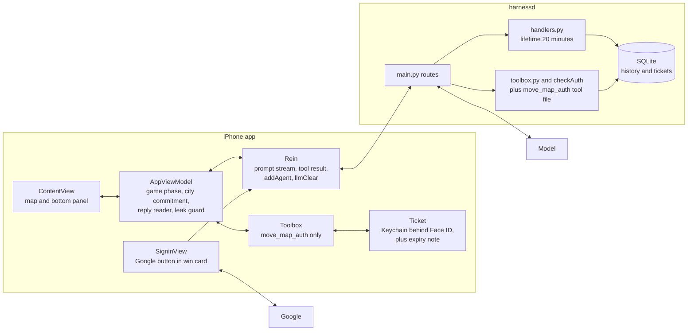

##### 2. Front-end responsibilities

The tutorial file names and roles are kept, and no files are added.

| File | Responsibility |
|---|---|
| ContentView | Full-screen map and the bottom panel from E-A v3. It also covers the keyboard behavior, the locate-me button (crossed out when location is denied, and opening Settings), and fly-to animation, using a quick cross-fade when Reduce Motion is on. |
| AppViewModel | Owns the single game phase, which mirrors the E-A state diagram, plus the map camera target, the city commitment, the reply reader, the leak guard, the game number, and the moderator log. Every Send and Clear rule, status line, and helper line is derived from the phase. It posts VoiceOver announcements once per segment end and on every status or win-card change. |
| Rein | Uses the existing prompt stream, tool-result route, addAgent, and llmClear. Its wait for a quiet stream is set to at least 5 minutes, so a slow sign-in doesn't drop the connection. |
| Toolbox | Runs move_map_auth: sanity checks, the approval wait, reading and attaching the ticket. Any other tool name gets the answer "not available in this game", and no device data is sent. |
| Ticket | The tutorial ticket, read and written to the rules in section 7. The non-secret expiry note lives in ordinary app settings. |
| SigninView | The Google button inside the win card. |

**Map ownership:**

- **At launch,** AppViewModel sets the camera to the user's location at neighborhood zoom. The location comes from the same source the tutorial's get_location uses. If location is denied, the camera shows the whole world.
- **On a win,** AppViewModel sets the camera target to the city and adds the pin.
- **On a new game,** it removes the pin and returns the camera to the user, or to the whole world.

##### 3. Back end

- **Code changes:** none, except the ticket lifetime constant (20 minutes, approved).
- **API, data format, schema:** unchanged. `/llmclear` is the only endpoint beyond the tutorials.
- **One new tool definition file, move_map_auth.** It follows get_weather_auth.json. It is marked as run on the device, like get_location, and as needing a ticket.
- **Course back end compatibility.** My app works there only if the course back end also has this file. Tickets there last 180 seconds, so a second win will usually ask for sign-in again, which is acceptable.
- **Course front end on my back end.** It is unaffected. It never receives move_map_auth calls, and a longer ticket lifetime doesn't change its behavior.

##### 4. Vocabulary: turns and segments

- **Turn:** everything the model streams in answer to one prompt. The prompt can be the game rules, a player message, or the hidden resend prompt (section 9). A turn may pause in the middle for a tool call.
- **Segment:** the text of a turn before a tool call, or after a tool result.
- **Message area:** each segment replaces it when the segment's first visible line arrives.
- **Hints:** a new set replaces the old one when its first hint arrives, as E-A specifies.
- **Leak guard and reveal decisions** are made at the end of each segment.

##### 5. Keeping the city fixed and hidden

**Commitment.** The model starts every turn with a hidden secret line listing the city's names, for example "[secret: New York City | New York | NYC]". The first secret line of a game commits those names. The model never sees anything else holding the city, so this line is what keeps it fixed.

```mermaid
stateDiagram-v2
    [*] --> NoCity: launch or Clear
    NoCity --> Committed: secret line in the opening turn
    Committed --> Committed: same city restated
    Committed --> Ended: game ends
    Ended --> Committed: first turn with new hints commits its secret line
    Ended --> NoCity: Clear
    Committed --> NoCity: Clear
```

After a game ends, a secret line naming a different city is held as "pending." It becomes the commitment only when the same turn delivers its first new hint. If no hints come, the old commitment stays.

**Matching city names.** Matching ignores capital letters and accents, and only whole words count. The rules forbid cities whose names are ordinary English words, such as Nice, Reading, Split, Mobile, or Bath.

**Leak guard.** Visible lines that name the committed city are held back until the segment ends. Then:

| The segment… | Result |
|---|---|
| ended with a move-map request, contained the end-of-game marker, or answered a guess that named the city | The held lines are shown. |
| named the city and contained no new hints | It is treated as the reveal. The lines are shown, the phase moves to Game Over, and the event is logged. Showing the city slightly early is a smaller harm than never showing it. |
| named the city and also contained new hints | It is mid-game. The city-naming lines are dropped and logged. |

**Drift check.** Each of the following writes a moderator log entry. The player sees nothing.

- A secret line mid-game shares no name with the commitment.
- A move-map request names a city outside the commitment.
- A game-ending segment contains none of the committed names.

##### 6. Reading the model's reply

**Markers,** each on its own line:

| Marker | Meaning |
|---|---|
| "Hint:" at the start of a line | A hint. |
| "[secret: …]" | The city commitment. |
| "[game over]" | The game has ended. |
| "[map ok]" | The ticket was accepted (section 7). |

**Rules for reading:**

- **Whole lines only.** Text is sorted only when a full line exists, so a marker split across chunks can't be misread.
- **Forgiving matching.** Markers are matched regardless of capitals, leading spaces, bullets, or bold.
- **Never displayed.** Markers never reach the screen.
- **Formatting.** In ordinary text, bold and italic are displayed as formatting, and leading bullet characters are removed.
- **Short lines.** The rules ask the model for short lines, because each line appears only when complete.

```mermaid
flowchart LR
    S["Streamed text"] --> B["Hold until a whole line"]
    B -->|"secret"| C["City commitment and drift check"]
    B -->|"Hint"| L{"Names the city?"}
    B -->|"game over"| E["Record end of game"]
    B -->|"map ok"| A["Accept, section 7"]
    B -->|"other text"| L
    L -->|"no"| D["Show: hints or message area"]
    L -->|"yes"| G["Hold until segment end, section 5"]
```

**When a marker is forgotten:**

| Missing | Effect |
|---|---|
| Hint prefix | The line goes to the message area, and old hints stay (E-A §6.3). |
| End-of-game marker | The leak guard's reveal rule ends the game. Otherwise the helper shows the fallback wording. |
| Secret line | It is logged, and the existing commitment stays. |
| "[map ok]" | Treated as rejected, which fails safe (section 7). It is logged. |

**JSON was rejected.** It can't stream, one bad character loses the whole reply, and the harness can't enforce it.

##### 7. The move-map tool, the ticket, and approval

**Sanity checks.** Toolbox auto-declines, with no card and a log entry, when:

- no guess has been made in this game,
- this is a second request in the same turn, unless it is the expected resend from section 9,
- the latitude or longitude is outside the possible range.

**The approval step:**

- The win card picks its wording from the expiry note, treating the ticket as expired 30 seconds early, and from whether Face ID is available.
- The keyboard closes, and the status reads "You got it!".
- **Approve:**
  1. Run Google sign-in if it's needed.
  2. Read the ticket through Face ID.
  3. Attach the ticket to the tool result. Its content says the map will be shown.
  4. Post the result on the existing tool-result route. The status reads "Moving the map…" with a spinner.
- **Not Now:** post a tool result with no ticket, whose content says the player declined.

**Acceptance fails closed.** The map flies only when one of these happens:

- the harness's reply to the tool-result post directly signals acceptance (preferred, if day-one testing shows such a signal exists),
- the first non-secret line of the continuation is "[map ok]".

Anything else is treated as rejected (section 9). On a decline, the app ignores markers, shows "The map stayed put.", and the game ends normally once the model names the city.

**Phase rule during approval.** From the move-map request until approval resolves, end-of-game markers are recorded but not acted on. Send and Clear stay disabled, and the helper line doesn't change. A resolved win always ends in Game Over.

**Ticket rules on the device path (R-Token):**

- The Keychain item is readable only after Face ID with the currently enrolled faces, only while the iPhone has a passcode, and it never leaves the device. This is the Secure Enclave-backed biometric protection.
- Every read uses a fresh Face ID check. An earlier check is never reused.
- After `/addagent` returns a ticket, the app saves it and discards its in-memory copy. It then reads the ticket back through Face ID, including on the first win.
- Replacing a ticket means deleting the old one, then saving the new one.
- If the tutorial's Ticket doesn't already meet these rules, the changes stay inside Ticket.

```mermaid
sequenceDiagram
    participant H as Harness and model
    participant T as Toolbox
    participant V as AppViewModel and win card
    participant K as Ticket
    H->>T: move_map_auth with names, lat, lon
    T->>T: sanity checks
    T->>V: show win card and wait
    alt approved
        V->>K: sign in if needed, save ticket
        K-->>T: ticket, after a fresh Face ID
        T->>H: tool result with ticket
        H-->>V: continuation
        V->>V: fly only on map ok or a direct accept signal
    else Not Now
        T->>H: tool result saying the player declined, no ticket
        H-->>V: continuation names the city
        V->>V: The map stayed put
    end
```

##### 8. Win card outcomes

| What happens | Card shown | Try Again resumes at |
|---|---|---|
| Google sign-in cancelled or failed | "Sign-in didn't finish." Try Again / Not Now | Google sign-in |
| Face ID cancelled or the scan failed | "Sign-in didn't finish." Try Again / Not Now | Face ID only, if a saved ticket is still valid. Otherwise Google sign-in. |
| Ticket missing or invalidated, for example Face ID re-enrolled or a partial reset | The expiry note is deleted. "Sign in to see the city on the map." Sign in with Google / Not Now | — |
| Face ID locked out or unavailable | "Face ID isn't available on this iPhone, so the map can't move." OK, which acts as Not Now | — |
| Harness rejects the ticket | "Your sign-in has expired. Sign in again to see the city." (section 9) | — |
| Tool-result post or stream fails | The card closes. Status: "The reply was cut off. Send again." Clear is enabled. | — |

##### 9. Recovering from a rejected ticket

1. The card reads "Confirm with Face ID". The player taps Show on Map, passes Face ID, and the result is posted.
2. The continuation's first non-secret line isn't "[map ok]", or the harness signals rejection directly.
3. The app treats this as rejected:
   - the map doesn't move,
   - the ticket and expiry note are deleted,
   - the expired card appears.

   The model's text, which names the city, stays in the message area. Its end-of-game marker is recorded but deferred.
4. **Not Now:** the status reads "The map stayed put.", and the phase moves to Game Over.
5. **Sign in with Google:**
   1. addAgent runs and the new ticket is saved.
   2. The app sends a hidden resend prompt on the existing prompt route: "The player signed in again. Send the move-map request again for the same city." The player never sees it.
   3. The model sends a new request. The approval was already given, so there is no card. Face ID runs, and the ticket is attached and posted.
   4. On "[map ok]", the map flies to the **original** coordinates and city name from this win, and the phase moves to Game Over.
6. **Second rejection:** "The map stayed put." It is logged, and the phase moves to Game Over. Only one re-sign-in is allowed per win.

If the model forgets "[map ok]" on a valid ticket, this path deletes a good ticket. That residual risk is logged, and a direct harness signal would remove it.

```mermaid
sequenceDiagram
    participant H as Harness and model
    participant V as App
    participant G as Google
    V->>H: tool result with stored ticket
    H-->>V: no map ok, city named, game over recorded
    V->>V: delete ticket, show expired card
    V->>G: Sign in with Google
    G-->>V: Google ID token
    V->>H: addagent
    H-->>V: new ticket, saved
    V->>H: hidden resend prompt
    H-->>V: new move_map_auth request
    V->>V: fresh Face ID, attach ticket
    V->>H: tool result with new ticket
    H-->>V: map ok
    V->>V: fly to original coordinates, Game Over
```

##### 10. Launch, Clear, and stranded tool calls

**Launch and Clear:**

1. Call `/llmclear`.
2. Send the rules.
3. When the opening turn ends, the game starts, even if it carried no recognizable hints.

If the harness can't be reached, the status reads "Couldn't start a game. Tap Clear to retry." Clear acts as retry.

**Game number.** Each game has a number. Clear cancels the old stream, and anything arriving for an older game is dropped.

**Stranded requests.** A request can be left unanswered only through the error path, because Clear is disabled during approval. If Clear is tapped while one is stranded:

1. Post the "player declined" result.
2. Wait for its continuation to finish or fail.
3. Then erase and send the rules.

If the decline post fails immediately, erase at once. The status stays "Starting a new game…" throughout.

**Relaunch after a force-quit.** The app can't answer old requests. The moderator restarts the harness before relaunching (section 11).

**Waiting.** The app keeps a quiet stream open for at least 5 minutes during approval. Any connection failure shows "The reply was cut off. Send again."

##### 11. Simulator and moderator notes

- **The Simulator path.** The tutorial's Ticket takes a separate path on the Simulator, which has no Secure Enclave. Face ID prompts, enrollment, and matching or non-matching faces behave the same, so the research questions are unaffected.
- **Secure Enclave check.** R-Token's Secure Enclave guarantee is shown once on a physical iPhone before sign-off. The sessions don't depend on it.
- **Reset between participants.** Use Erase All Content and Settings. It clears the Keychain, app settings, Google's saved sign-in, and location permission. The 20-minute lifetime doesn't affect the reset.
- **Location.** Set a fixed Simulator location from the Features menu so the map starts at a sensible place.
- **Hung reply.** Restart the harness, then relaunch the app. This changes E-A §11 and needs E-A sign-off.
- **Expect line-at-a-time display.** Long model lines appear all at once.
- **Before each session,** run one full win and check the moderator log for drift, leak, and missing-marker entries.

##### 12. What the game rules must ask of the model

1. Pick one real city whose names are not ordinary English words. Keep it for the whole game.
2. Start every turn with the secret line listing the city's names. Never name the city elsewhere until the game ends.
3. Write short lines. Put each hint on its own line starting with "Hint:". No hint names the city.
4. Only one tool exists: move_map_auth. On a correct guess, write a verdict naming the city, then send move_map_auth once with the city's name, latitude, and longitude.
5. If the move-map result says the map will be shown, start the continuation with "[map ok]". Otherwise don't. In every case, name the city and end the game.
6. End every finished game with "[game over]" as the last line.
7. Treat "I give up" and similar phrases as giving up. Treat "yes" after a game as a new game with a new city and a new secret line.
8. If asked to resend the move-map request, resend it for the same city, then write one short play-again line.

##### 13. Day-one checks, before UI work

1. Does `_checkAuth` run on results returned from the device? If not, R-Token can't be met without a back-end change, and this must be escalated. This is the blocker.
2. Can one tool file mark a tool as both run on the device and needing a ticket?
3. What does the tool-result post itself return when the ticket is valid, rejected, or absent? Does a no-ticket decline reach the model, get refused in a way the model sees, or get rejected outright?
4. Which tools does the model see in this app?
5. Does the harness store the model's text word for word, including secret lines? Does the ticket land in history?
6. Does the harness wait at least 5 minutes for a tool result? Does the app's stream stay open that long? When is a turn written to history?
7. What does `/llmclear` erase, and does it touch the tickets table?
8. Does the tutorial code confirm that the front end attaches the ticket, as its summary states?

##### 14. Rejected as out of scope

- **Geocoder check of the model's coordinates:** hardening. The range check is enough for a prototype.
- **Detecting swapped or wrong-but-plausible coordinates:** hardening, for the same reason.
- **App-side give-up detection to block move-map:** the model judges give-ups (E-A §8).
- **Automatic timeouts and retries for hung replies:** excluded by E-A §1. The moderator restarts instead.
- **A reset procedure for physical iPhones:** sessions run on the Simulator.
- **Full alias and transliteration handling for city names:** the model-supplied alias list is enough.
- **Hiding the city from the network and database:** accepted by the owner.

##### 15. Residual risks

- A forgotten "[map ok]" turns a valid win into a re-sign-in. A direct harness signal, if day-one testing finds one, removes this risk.
- The model may ignore the common-word city rule. The leak guard then drops a harmless line, and it is logged.
- The hidden resend prompt asks the model to act after "game over". Its behavior is checked in the pre-session win run.

---

<a id="goldfish-summaries"></a>
## Goldfish Summaries

### Exhibit G-A — one-page summary of all Goldfish 1 rounds

*One round was run, on E-A v1, by a reviewer who saw only the spec. Its findings drove E-A v2.*

**What the reviewer understood correctly.** One game screen: read hints, type a city, and win a map fly-to. It also correctly found a second "screen," the system sign-in and Face ID takeover at the winning moment.

**Main criticisms:**
1. **Wrong visual priority.** The full-screen map looked like the thing to play with, but the actual game lived in a small strip at the bottom. Opening on the user's own neighborhood could suggest the city is nearby.
2. **"Clear" was misleading.** People would read it as "empty the text box." It sat next to the last guess, had no confirmation, and oddly kept the typed text.
3. **The turn line was overloaded.** It held guesses, verdicts, spinners, statuses, the model's text, reveals and errors in three capped rows, with no rule for overflow.
4. **The win gate felt like a punishment.** An unexplained Google alert appeared out of nowhere, cancelling was permanent with no retry, the failure message read like blame, and a surprise Face ID permission prompt appeared on the second win.
5. **Inconsistencies.** Giving up didn't show the city on the map, and the old city's pin and view carried into the next game.
6. **Not buildable from the spec alone.** It referred to an undefined "challenge 1" and "requirement 3d," and it left undefined the harness data format, the hint markers, the end-of-game marker, the tool-call format, token expiry, and the Face ID unavailable or locked-out cases. It also had logic contradictions: "Tap Send to try again" with an empty box, missing Clear paths, and whether "You got it!" is replaced or appended to.

**How they were resolved (in E-A v2):**
- **Rejected where requirements force the design:** the map is the hero and launches on the user's location, the button is named "Clear," hints overwrite, sign-in is required, and giving up doesn't move the map. Each rejection cited the requirement.
- **Accepted:**
  - the status row was split from the message area,
  - Clear moved and got a confirmation,
  - an in-panel win card explains the gate, with the user starting it and offering Try Again or Not Now,
  - all first-time prompts now happen on the first win,
  - the map resets on a new game,
  - a cut-off reply puts the guess back in the text box,
  - the spec became self-contained,
  - iPhone portrait only.
- **Deferred to technical design (E-B):** data format, markers, tool-call format, and sign-in plumbing.

**What remained.** Only back-end plumbing questions, which were deliberately moved to E-B. The audit also exposed a v1 requirement error: the first win skipped Face ID. v2 fixed it.

### Exhibit G-B — one-page summary of all Goldfish 2 rounds

*One round was run, on E-A v2, by a reviewer who had the spec, the design requirements, and the look-and-feel preferences. Its findings drove E-A v3 (FINAL).*

**Verdict:** E-A v2 covered every stated requirement, but stretched some, crowded the panel, and added unrequired polish and hardening.

**Requirement risks found:**
- The token exchange might need a harness API change, which is forbidden.
- The win card couldn't know whether the token was valid without reading it, and every read needs Face ID.
- Send's spinner ran while the app was only waiting on the user.
- Compliance with the architecture baseline (SwiftUI, MapKit, the tutorials) couldn't be checked.
- "Not Now" seemed to skip the required tool call.
- The state diagram was missing paths.
- The status row couldn't be both one fixed line and two lines.
- The return key's states were unclear.
- Clear wiped a half-typed guess.

**Look-and-feel and HIG conflicts:**
- The panel (up to 45% of the screen) undercut the map-is-hero preference.
- The panel was crowded.
- Clear's touch target wasn't specified.
- Dimming the hints to 40% would fail contrast.
- The Google prompts weren't acknowledged as an exception to "no full-screen interruptions."
- "Show on Map" lacked Google's sign-in branding.

**Unrequired additions flagged:** the Tried row, the helper line, the Clear confirmation, the locate-me button and location note, the pin and haptic, the "Reset sign-in" Settings switch, reliability hardening (stall timeouts, guess restore, background recovery, win timeout), and a hinted harness login.

**How they were resolved (in E-A v3 FINAL):**
- **Accepted:**
  - the token exchange uses the existing llmHITL `/addagent` endpoint, with no API change and no harness login,
  - a non-secret expiry note picks the card's wording,
  - the spinner shows only during real work,
  - flows are mapped onto llmTools and llmHITL, and SwiftUI and MapKit are named,
  - Not Now is defined as the llmHITL "decline" path, so the tool call still happens,
  - the status row is one line,
  - the panel cap is one third of the screen,
  - "Previous hints" uses secondary color instead of fading,
  - Google's standard sign-in button is used,
  - the Tried row, the Reset switch, the location note, the haptic, and the reliability hardening were dropped,
  - Clear keeps the typed guess.
- **Rejected, with reasons:** the status row, message area, and win card each serve a requirement; the text "Clear" label is kept for research question 4; the helper line, Clear confirmation, and locate-me button are kept as my product decisions.

**What remained.** One question about resetting test sessions on physical iPhones. It's moot because sessions run on the Simulator. The remaining critique had become decisions already taken, so E-A v3 was declared FINAL.

### Exhibit G-C — one-page summary of all Goldfish 3 rounds

*One round was run, on E-B v2, by a senior-engineer reviewer who had E-B, the design requirements, and E-A FINAL. Its findings drove E-B v3 (FINAL).*

**Critical findings:**
- **C1.** The committed city never reset between games.
- **C2.** The leak guard could swallow the actual reveal.
- **C3.** The map-move acceptance check failed *open*: anything but a refusal moved the map.
- **C4.** Not Now relied on the harness refusing a ticketless result.

**Significant findings:**
- **S1.** Clear's "answer before erasing" guard recreated the very race it was meant to stop.
- **S2.** A game-over marker could conflict with the expired-ticket card.
- **S3.** Ticket read failures weren't mapped to outcomes.
- **S4.** "Every read goes through Face ID" was asserted, not designed.
- **S5.** App-side wait times were undefined.
- **S6.** Other tools were still offered to the model.
- **S7.** Side effects of the longer ticket lifetime weren't addressed.
- **S8.** City-name matching was weak (aliases, accents, common-word cities).
- **S9.** Line-at-a-time display could stall.

**Minor findings:** unexpected or duplicate move-map requests, a misleading status during acceptance, undefined "reply," a resend naming a different city, a game starting without hints, raw formatting in text, a relaunch note that changed E-A, and unassigned view work, including R-Map.

**How they were resolved (in E-B v3 FINAL):**
- **City lifecycle.** A new game commits its own city, and launch and Clear reset it.
- **Leak guard.** A segment that names the city with no new hints is treated as the reveal.
- **Acceptance.** It now fails *closed*: the map moves only on a positive `[map ok]` marker or a direct harness accept signal.
- **Not Now.** It posts an explicit "player declined" result.
- **Clear.** It waits for the decline's continuation before erasing.
- **Approval.** End markers are deferred until approval resolves.
- **Ticket.** There is a full win-card outcome table, with Try Again resuming at the first unfinished step. Device-path rules (fresh Face ID per read, Secure Enclave) are spelled out, along with the Simulator caveat.
- **Waits and tools.** The app waits at least 5 minutes, and Toolbox refuses every tool except `move_map_auth`.
- **City names.** An alias list, matching that ignores capitals and accents, and no common-word cities.
- **Sanity checks.** Auto-decline when no guess has been made yet, on duplicate requests, and on impossible coordinates.
- **Smaller fixes.** "Moving the map…" status, defined "turn" and "segment," the fly-to uses the original coordinates, and an ownership table for map and view work.

**Rejected as out of scope:** geocoder checks of coordinates, swapped-coordinate detection, app-side give-up detection, automatic timeouts and retries, physical-iPhone reset procedures, full transliteration handling, and hiding the city from the network and database (accepted by the owner).

**What remained.** Three residual risks, accepted and logged: a forgotten `[map ok]` turns a valid win into a re-sign-in, the model may ignore the common-word rule, and model behavior on the hidden resend prompt. Plus the day-one blocker check: does `_checkAuth` run on device-returned results? E-B v3 was declared FINAL.

